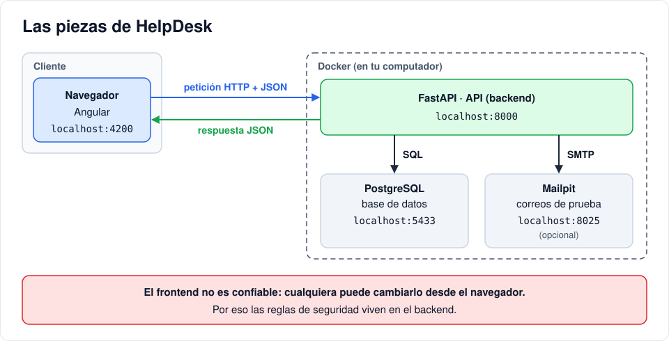

# Iteración 00 · Antes de empezar

[← Índice](README.md) · [01 · Tu primera API →](01-primera-api.md) <!-- nav -->

**Clase:** martes 13 de octubre · **Entra en:** parcial 1 · **Duración:** 40 min · **Temas del plan:** arquitectura de sistemas web, modelo cliente-servidor, Git, asistentes de código.

## Lo que vas a construir

Todavía nada de código. Vas a dejar listo el computador, entender qué piezas tiene el sistema y crear el repositorio donde vas a construir el proyecto de aquí al final del curso. Ese repositorio es lo que se evalúa en los dos parciales, así que cuídalo desde hoy.

> Si la instalación de alguna herramienta no termina en clase (Docker suele ser la más demorada), termínala en casa **antes del martes 20 de octubre**, junto con la iteración 01. Ese día se arranca directamente con la 02.

## Antes de programar

Vamos a construir un sistema de **tickets de soporte**: un usuario reporta un problema ("no me funciona el correo") y alguien del equipo de soporte lo atiende. Antes de mirar cualquier código, responde en una hoja:

1. ¿Qué datos tiene un ticket? Escribe la lista de campos.
2. ¿Qué tipos de personas usan el sistema? ¿Qué puede hacer cada una?
3. ¿Un usuario normal debería ver los tickets de otros usuarios? ¿Por qué?

Guarda esa hoja. Al final de la iteración la vas a comparar con el diseño del proyecto.

## Conceptos

### Cliente y servidor

Cuando abres una página web pasan dos cosas en dos computadores distintos:

- El **cliente** (tu navegador) muestra la interfaz y le pide cosas al servidor.
- El **servidor** guarda los datos, aplica las reglas y responde.

Se comunican con un protocolo llamado **HTTP**: el cliente envía una *petición* y el servidor devuelve una *respuesta*. **HTTPS** es lo mismo, pero cifrado, para que nadie en la mitad del camino (por ejemplo, alguien en el mismo wifi) pueda leer o modificar lo que viaja.

Nuestro sistema tiene cuatro piezas:



- **Angular** (frontend): lo que el usuario ve y toca.
- **FastAPI** (backend): una API escrita en Python. Recibe peticiones, valida, decide quién puede hacer qué y habla con la base de datos.
- **PostgreSQL**: la base de datos donde quedan guardados usuarios y tickets.
- **Mailpit**: un servidor de correo falso para ver los correos que el sistema enviaría.

Una idea que vas a ver repetida en toda la guía: **el frontend no es confiable**. Cualquier persona puede abrir las herramientas del navegador y cambiar lo que quiera. Por eso las reglas de seguridad viven en el backend.

### Docker en dos frases

Un **contenedor** es un proceso aislado que trae todo lo que necesita para correr (sistema base, Python, librerías). Una **imagen** es la receta congelada a partir de la cual se crean contenedores.

Gracias a Docker no necesitas instalar Python ni PostgreSQL: los dos corren en contenedores, y todo el grupo tiene exactamente las mismas versiones.

### Git

Git guarda la historia de tu proyecto en *commits*: fotos del código con un mensaje que explica qué cambió. Al final de cada iteración vas a hacer un commit. Si algo se daña, puedes volver a la última versión buena.

### Cómo usar la IA en este curso

La IA es una herramienta que ayuda, pero quien entiende y responde por el código eres tú. Reglas:

1. **Primero piensa, después pide.** Responde las preguntas de "Antes de programar" sin IA.
2. **Úsala para lo repetitivo:** estructura de archivos, estilos, datos de prueba.
3. **Nunca pegues código que no puedas explicar línea por línea.** Si no lo entiendes, pregúntale *por qué*, no *qué*.
4. **Desconfía.** La IA mezcla versiones viejas de las librerías e inventa funciones que no existen. En la iteración 14 vas a practicar cómo detectarlo.

## Paso a paso

### 1. Instala las herramientas

| Programa | Para qué | Descarga |
|---|---|---|
| Git | Control de versiones | https://git-scm.com/downloads |
| Docker Desktop | Backend y base de datos | https://www.docker.com/products/docker-desktop |
| Node.js (versión LTS más reciente) | Angular | https://nodejs.org |
| Visual Studio Code | Editor | https://code.visualstudio.com |

Comprueba en una terminal que cada uno responde con una versión:

```bash
git --version
docker --version
node --version
```

Abre Docker Desktop y espera a que diga **Engine running**.

### 2. Descarga el proyecto de referencia

Es el proyecto terminado. No es para copiarlo: es para comparar cuando te atasques y para tomar algunos archivos que la guía te va a indicar. Ubícate en la carpeta donde guardas tus proyectos y ejecuta:

```bash
git clone https://github.com/RichardBolanos/helpdesk.git helpdesk-referencia
```

### 3. Crea tu repositorio

En **la misma carpeta** (al lado de `helpdesk-referencia`, no dentro):

```bash
mkdir helpdesk
cd helpdesk
git init
```

Crea el archivo `.gitignore` en la raíz con este contenido:

```gitignore
__pycache__/
*.pyc
node_modules/
dist/
.angular/
```

Este archivo le dice a Git qué **no** guardar: dependencias que se descargan solas y archivos que se generan al compilar.

Al terminar la guía, la carpeta se verá así:

```
helpdesk/
├── .env                  configuración (claves, puertos)
├── docker-compose.yml    cómo se levantan los contenedores
├── backend/              API en FastAPI
└── frontend/             aplicación en Angular
```

## Comprueba

- Los tres comandos de versión responden sin error.
- Docker Desktop dice *Engine running*.
- Dentro de `helpdesk/` existe la carpeta oculta `.git` (en Windows: `Get-ChildItem -Force`).

Ahora compara tu hoja con el diseño del proyecto:

| Rol | Puede |
|---|---|
| `user` | Registrarse, crear tickets y ver solo los suyos |
| `agent` | Ver todos los tickets y cambiar su estado |
| `admin` | Todo lo anterior, borrar tickets y gestionar usuarios |

Un ticket tiene: título, descripción, prioridad (`low`, `medium`, `high`), estado (`open`, `in_progress`, `closed`), fecha de creación y autor.

## Para pensar

- ¿Qué campos pensaste tú que no están en el diseño? ¿Qué campos tiene el diseño que no pensaste? No hay respuesta única: discútelo con tu compañero.
- Si el servidor está en Bogotá y el usuario en Manizales, ¿qué pieza del diagrama está en cada ciudad?

## Guarda tu avance

```bash
git add .
git commit -m "chore: estructura inicial del proyecto"
```

---

[← Índice](README.md) · [01 · Tu primera API →](01-primera-api.md) <!-- nav -->
