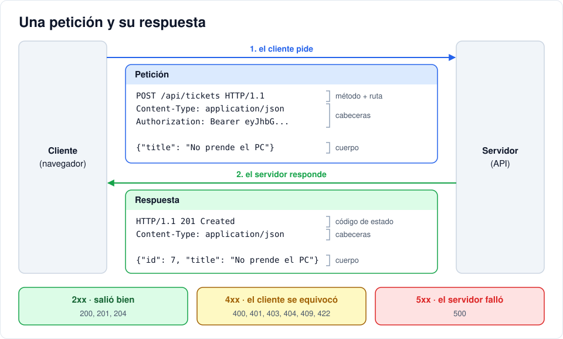

# Iteración 01 · Tu primera API

[← 00 · Antes de empezar](00-antes-de-empezar.md) · [Índice](README.md) · [02 · Base de datos y modelos →](02-base-de-datos.md) <!-- nav -->

**Clase:** martes 13 de octubre · **Entra en:** parcial 1 · **Duración:** 40 min · **Temas del plan:** protocolo HTTP/HTTPS, modelo cliente-servidor.

## Lo que vas a construir

Una API mínima que corre en Docker y responde `{"status": "ok"}` en `http://localhost:8000/api/health`.

## Antes de programar

1. Cuando escribes una dirección en el navegador y oprimes Enter, ¿qué le envía el navegador al servidor? Intenta describirlo.
2. Si el servidor tiene un error interno, ¿cómo se entera el navegador? ¿Solo por el texto de la respuesta?

## Conceptos

### Anatomía de una petición y una respuesta HTTP

Una **petición** tiene:

```
POST /api/tickets HTTP/1.1                ← método + ruta
Host: localhost:8000                      ← cabeceras (headers):
Content-Type: application/json               información sobre la petición
Authorization: Bearer eyJhbGci...

{"title": "No prende el PC"}              ← cuerpo (body): los datos
```

Una **respuesta** tiene:

```
HTTP/1.1 201 Created                      ← código de estado
Content-Type: application/json            ← cabeceras

{"id": 7, "title": "No prende el PC"}     ← cuerpo
```



### Métodos: qué quiere hacer el cliente

| Método | Intención | En este proyecto |
|---|---|---|
| `GET` | Leer, sin cambiar nada | Listar tickets |
| `POST` | Crear algo nuevo | Crear un ticket, iniciar sesión |
| `PATCH` | Modificar una parte | Cambiar el estado de un ticket |
| `PUT` | Reemplazar completo | No lo usamos |
| `DELETE` | Borrar | Borrar un ticket |

### Códigos de estado: cómo le fue a la petición

El primer dígito dice la familia: **2xx** salió bien, **4xx** el cliente se equivocó, **5xx** el servidor falló. Estos son los que vamos a usar:

| Código | Significado | Ejemplo |
|---|---|---|
| 200 | OK | Lista de tickets |
| 201 | Creado | Ticket nuevo |
| 204 | Sin contenido | Ticket borrado (no hay nada que devolver) |
| 400 | Petición incorrecta | Un admin intenta quitarse su propio rol |
| 401 | No autenticado | No enviaste token o venció |
| 403 | Prohibido | Estás autenticado, pero tu rol no puede hacer eso |
| 404 | No encontrado | El ticket 999 no existe |
| 409 | Conflicto | El email ya está registrado |
| 422 | Datos inválidos | Falta el título |

### JSON

Es el formato en que viajan los datos: texto con objetos `{}`, listas `[]`, textos, números, `true`/`false` y `null`. Python y JavaScript lo convierten a sus propios tipos sin esfuerzo.

### FastAPI

Es un framework de Python para construir APIs. Escribes una función normal y le pones un **decorador** (`@app.get(...)`) que dice "cuando llegue un GET a esta ruta, ejecuta esta función". Lo que la función retorna se convierte en JSON.

## Paso a paso

### 1. Dependencias de Python

Crea `backend/requirements.txt`. Están todas las del proyecto para no tener que reconstruir la imagen a cada rato; el comentario dice en qué iteración se usa cada una.

```text
fastapi>=0.115            # 01: el framework de la API
uvicorn[standard]>=0.30   # 01: el servidor que ejecuta la API
sqlalchemy>=2.0           # 02: ORM para hablar con la base de datos
psycopg[binary]>=3.2      # 02: driver de PostgreSQL
pydantic[email]>=2.7      # 03: validación de datos (incluye validar emails)
pydantic-settings>=2.3    # 02: leer la configuración desde variables de entorno
PyJWT>=2.8                # 04: crear y verificar tokens JWT
bcrypt>=4.1               # 02: hash de contraseñas
```

### 2. La imagen de Docker

Crea `backend/Dockerfile`:

```dockerfile
FROM python:3.12-slim

WORKDIR /code
ENV PYTHONDONTWRITEBYTECODE=1 PYTHONUNBUFFERED=1

COPY requirements.txt .
RUN pip install --no-cache-dir -r requirements.txt

COPY app ./app

CMD ["uvicorn", "app.main:app", "--host", "0.0.0.0", "--port", "8000"]
```

Léelo de arriba hacia abajo: parte de una imagen que ya trae Python 3.12, instala las dependencias y copia el código. La última línea es el comando que se ejecuta al arrancar el contenedor.

### 3. El código de la API

Crea `backend/app/__init__.py` **vacío** (le dice a Python que la carpeta `app` es un paquete y permite importar entre sus archivos).

Crea `backend/app/main.py`:

```python
from fastapi import FastAPI

app = FastAPI(title="HelpDesk API")


@app.get("/api/health")
def health():
    return {"status": "ok"}
```

### 4. Docker Compose

Compose permite describir varios contenedores en un archivo y levantarlos con un solo comando. Por ahora solo hay uno. Crea `docker-compose.yml` en la raíz:

```yaml
services:
  api:
    build: ./backend
    ports:
      - "8000:8000"
    volumes:
      - ./backend/app:/code/app
    command: uvicorn app.main:app --host 0.0.0.0 --port 8000 --reload
```

- `ports: "8000:8000"`: el formato es `puerto_de_tu_PC:puerto_del_contenedor`. Sin esto, la API existiría pero nadie de afuera podría llegarle.
- `volumes`: conecta tu carpeta `backend/app` con la del contenedor. Así, cuando guardas un archivo, el contenedor ve el cambio.
- `--reload`: reinicia la API cada vez que cambia el código. Solo para desarrollo.

### 5. Levántalo

```bash
docker compose up -d --build
docker compose ps
```

`-d` deja el contenedor corriendo en segundo plano. `--build` construye la imagen. Debes ver el servicio `api` con estado *Up*.

## Comprueba

1. Abre http://localhost:8000/api/health. Debe aparecer `{"status":"ok"}`.
2. Abre las herramientas de desarrollador del navegador (F12), pestaña **Network** (Red), y recarga. Haz clic en la petición `health` y encuentra: el método, el código de estado y la cabecera `content-type` de la respuesta.
3. Abre http://localhost:8000/docs. FastAPI genera esta documentación sola a partir de tu código. La vas a usar mucho para probar.

Si algo falla, mira los registros: `docker compose logs -f api`.

## Para pensar

- Antes de probarlo, predice: ¿qué código de estado devuelve un `POST` a `/api/health`? Desde `/docs` no se puede probar (solo aparece el GET), así que ejecuta en la terminal `curl.exe -i -X POST http://localhost:8000/api/health` (en Mac o Linux, sin el `.exe`). ¿Acertaste? ¿Qué significa ese código?
- **Reto:** agrega un endpoint `GET /api/hello/{name}` que responda `{"message": "Hola, <name>"}`. Pista: el parámetro de la función se debe llamar igual que lo que está entre llaves.

## Guarda tu avance

```bash
git add .
git commit -m "feat(api): primera API con FastAPI en Docker"
```

---

[← 00 · Antes de empezar](00-antes-de-empezar.md) · [Índice](README.md) · [02 · Base de datos y modelos →](02-base-de-datos.md) <!-- nav -->
