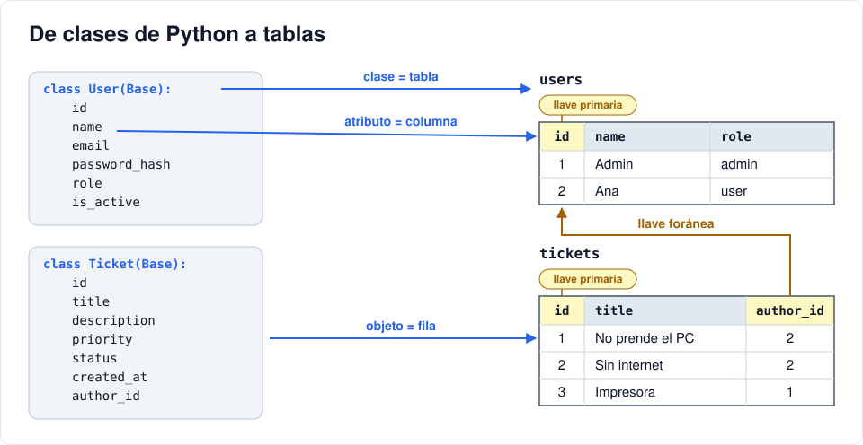
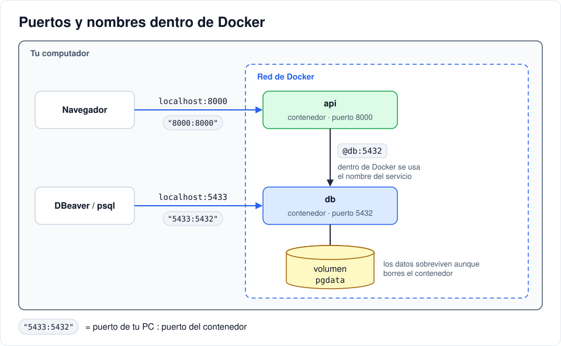

# Iteración 02 · Base de datos y modelos

[← 01 · Tu primera API](01-primera-api.md) · [Índice](README.md) · [03 · CRUD de tickets →](03-crud-tickets.md) <!-- nav -->

**Clase:** martes 20 de octubre · **Entra en:** parcial 1 · **Duración:** 45 min · **Temas del plan:** arquitectura de sistemas web, seguridad de datos.

## Lo que vas a construir

Un contenedor con PostgreSQL, las tablas `users` y `tickets` creadas automáticamente desde Python, y un usuario administrador que se crea solo al arrancar.

## Antes de programar

1. Revisa la lista de campos del ticket que hiciste en la iteración 00. ¿Qué tipo de dato es cada uno (texto corto, texto largo, número, fecha, una opción entre varias)?
2. ¿Cómo sabe un ticket quién es su autor? ¿Guardarías el nombre del autor dentro del ticket o algo distinto? ¿Qué pasa si el autor cambia de nombre?
3. Si alguien se roba la base de datos, ¿qué debería encontrar en la columna de contraseñas?

## Conceptos

### Tablas, llave primaria y llave foránea

Una base de datos relacional guarda la información en **tablas**: filas (registros) y columnas (campos).

- La **llave primaria** (`id`) identifica cada fila de forma única.
- La **llave foránea** (`author_id`) es una columna que guarda el `id` de una fila de otra tabla. Así el ticket apunta a su autor sin copiar sus datos. Si el autor cambia de nombre, se cambia en un solo lugar.



### ORM: tablas como clases

Escribir SQL a mano para todo es repetitivo y propenso a errores. Un **ORM** (aquí, SQLAlchemy) traduce:

| Python | Base de datos |
|---|---|
| Clase `User` | Tabla `users` |
| Atributo `email` | Columna `email` |
| Un objeto `User(...)` | Una fila |

Tú trabajas con objetos y el ORM genera el SQL.

### Variables de entorno

La contraseña de la base de datos no debe estar escrita dentro del código: el código se comparte, se sube a GitHub, se copia. Por eso la configuración va en **variables de entorno**, que en este proyecto se definen en el archivo `.env`.

> En este curso el `.env` se sube al repositorio porque tiene valores de prueba y así todos arrancan sin configurar nada. **En un proyecto real, el `.env` va en el `.gitignore`** y se comparte un `.env.example` sin valores secretos.

### Hash de contraseñas

Un **hash** es una función de una sola vía: de `Admin12345` sale `$2b$12$Kx9...`, pero del resultado no se puede volver a la contraseña. Para verificar un login, se calcula el hash de lo que escribió el usuario y se compara.

Esto es distinto de **cifrar**: lo cifrado se puede descifrar con la clave. Las contraseñas nunca se cifran, se les saca hash. Usamos **bcrypt**, que además agrega una *sal* aleatoria (por eso dos usuarios con la misma contraseña tienen hashes distintos) y es lento a propósito para que probar millones de contraseñas sea costoso.

### Python en un minuto (lo que vas a leer hoy)

- Los bloques se marcan con **sangría**, no con llaves.
- `name: Mapped[str]` es una **anotación de tipo**: dice qué tipo de dato es el atributo. SQLAlchemy la usa para saber qué columna crear.
- `class Role(str, enum.Enum)` define una lista cerrada de opciones. Un rol solo puede ser `user`, `agent` o `admin`.
- `with ... as db:` abre un recurso y garantiza que se cierre al salir del bloque, aunque haya un error.

## Paso a paso

### 1. Configuración

Crea `.env` en la raíz:

```env
POSTGRES_USER=helpdesk
POSTGRES_PASSWORD=helpdesk_dev_pw
POSTGRES_DB=helpdesk

# Admin inicial (se crea al arrancar si no existe)
ADMIN_EMAIL=admin@helpdesk.com
ADMIN_PASSWORD=Admin12345
```

Crea `backend/app/config.py`:

```python
from pydantic_settings import BaseSettings, SettingsConfigDict


class Settings(BaseSettings):
    model_config = SettingsConfigDict(env_file=".env", extra="ignore")

    database_url: str
    admin_email: str = "admin@helpdesk.com"
    admin_password: str


settings = Settings()
```

`Settings` lee las variables de entorno y las convierte al tipo indicado. `DATABASE_URL` llena `database_url` (no distingue mayúsculas). Si falta una obligatoria, la API no arranca y te dice cuál falta: es mejor fallar al inicio que a mitad de una petición.

### 2. Agrega PostgreSQL a Compose

Reemplaza `docker-compose.yml`:

```yaml
services:
  db:
    image: postgres:16-alpine
    environment:
      POSTGRES_USER: ${POSTGRES_USER}
      POSTGRES_PASSWORD: ${POSTGRES_PASSWORD}
      POSTGRES_DB: ${POSTGRES_DB}
    ports:
      - "5433:5432"
    volumes:
      - pgdata:/var/lib/postgresql/data
    healthcheck:
      test: ["CMD-SHELL", "pg_isready -U ${POSTGRES_USER} -d ${POSTGRES_DB}"]
      interval: 3s
      timeout: 3s
      retries: 10

  api:
    build: ./backend
    env_file: .env
    environment:
      DATABASE_URL: postgresql+psycopg://${POSTGRES_USER}:${POSTGRES_PASSWORD}@db:5432/${POSTGRES_DB}
    ports:
      - "8000:8000"
    depends_on:
      db:
        condition: service_healthy
    volumes:
      - ./backend/app:/code/app
    command: uvicorn app.main:app --host 0.0.0.0 --port 8000 --reload

volumes:
  pgdata:
```

Detalles que importan:

- `${POSTGRES_USER}`: Compose reemplaza esto con el valor del `.env`.
- En `DATABASE_URL` el servidor se llama `db`, no `localhost`. Dentro de Docker, cada servicio se encuentra con los otros **por su nombre**. Para la API, `localhost` sería el mismo contenedor de la API.
- `5433:5432`: desde tu PC entras por el 5433 (para no chocar si ya tienes un PostgreSQL instalado); entre contenedores se usa el 5432.
- `pgdata` es un **volumen**: guarda los datos fuera del contenedor. Si borras el contenedor, los datos siguen ahí.
- `healthcheck` + `depends_on`: la API espera a que la base de datos esté lista para recibir conexiones.



### 3. Conexión a la base de datos

Crea `backend/app/database.py`:

```python
from sqlalchemy import create_engine
from sqlalchemy.orm import DeclarativeBase, sessionmaker

from .config import settings

engine = create_engine(settings.database_url, pool_pre_ping=True)
SessionLocal = sessionmaker(bind=engine, autoflush=False)


class Base(DeclarativeBase):
    pass


def get_db():
    db = SessionLocal()
    try:
        yield db
    finally:
        db.close()
```

- `engine`: administra las conexiones con PostgreSQL.
- `SessionLocal`: fábrica de **sesiones**. Una sesión es una conversación con la base de datos: agregas, modificas y al final confirmas con `commit()`.
- `Base`: todas las clases que hereden de aquí se convierten en tablas.
- `get_db` la usaremos en la iteración 03. Por ahora fíjate en el `finally`: la sesión se cierra pase lo que pase.

### 4. Los modelos

Crea `backend/app/models.py`:

```python
import enum
from datetime import datetime, timezone

from sqlalchemy import DateTime, Enum, ForeignKey, String, Text
from sqlalchemy.orm import Mapped, mapped_column, relationship

from .database import Base


class Role(str, enum.Enum):
    user = "user"
    agent = "agent"
    admin = "admin"


class TicketStatus(str, enum.Enum):
    open = "open"
    in_progress = "in_progress"
    closed = "closed"


class Priority(str, enum.Enum):
    low = "low"
    medium = "medium"
    high = "high"


def utcnow() -> datetime:
    return datetime.now(timezone.utc)


class User(Base):
    __tablename__ = "users"

    id: Mapped[int] = mapped_column(primary_key=True)
    name: Mapped[str] = mapped_column(String(100))
    email: Mapped[str] = mapped_column(String(255), unique=True, index=True)
    password_hash: Mapped[str] = mapped_column(String(255))
    role: Mapped[Role] = mapped_column(Enum(Role), default=Role.user)
    is_active: Mapped[bool] = mapped_column(default=True)


class Ticket(Base):
    __tablename__ = "tickets"

    id: Mapped[int] = mapped_column(primary_key=True)
    title: Mapped[str] = mapped_column(String(120))
    description: Mapped[str] = mapped_column(Text)
    priority: Mapped[Priority] = mapped_column(Enum(Priority), default=Priority.medium)
    status: Mapped[TicketStatus] = mapped_column(Enum(TicketStatus), default=TicketStatus.open)
    created_at: Mapped[datetime] = mapped_column(DateTime(timezone=True), default=utcnow)
    author_id: Mapped[int] = mapped_column(ForeignKey("users.id"))

    author: Mapped[User] = relationship(lazy="joined")
```

Compara con tu respuesta de "Antes de programar":

- `email` es `unique=True`: la base de datos rechaza dos usuarios con el mismo correo, aunque el código tenga un error.
- `String(120)` es texto corto con límite; `Text` es texto largo sin límite práctico.
- Las fechas se guardan en **UTC** (hora universal). Cada navegador la convierte a la hora local; así no hay líos si el servidor está en otro país.
- `author_id` es la llave foránea. `author` no es una columna: es un atajo para que `ticket.author.name` traiga el usuario completo. `lazy="joined"` significa que el autor se trae en la misma consulta que el ticket.

### 5. Hash de contraseñas

Crea `backend/app/security.py`:

```python
import bcrypt


def hash_password(password: str) -> str:
    return bcrypt.hashpw(password.encode(), bcrypt.gensalt()).decode()


def verify_password(password: str, password_hash: str) -> bool:
    return bcrypt.checkpw(password.encode(), password_hash.encode())
```

`encode()` convierte el texto a bytes, porque bcrypt trabaja con bytes. `gensalt()` genera la sal aleatoria.

### 6. Crear las tablas y el admin al arrancar

Reemplaza `backend/app/main.py`:

```python
import time
from contextlib import asynccontextmanager

from fastapi import FastAPI
from sqlalchemy import select
from sqlalchemy.exc import OperationalError

from .config import settings
from .database import Base, SessionLocal, engine
from .models import Role, User
from .security import hash_password


def init_db():
    for _ in range(10):  # la BD puede tardar unos segundos en aceptar conexiones
        try:
            Base.metadata.create_all(engine)
            break
        except OperationalError:
            time.sleep(2)
    else:
        raise RuntimeError("No se pudo conectar a la base de datos")

    with SessionLocal() as db:
        email = settings.admin_email.lower()
        if not db.scalar(select(User).where(User.email == email)):
            db.add(
                User(
                    name="Admin",
                    email=email,
                    password_hash=hash_password(settings.admin_password),
                    role=Role.admin,
                )
            )
            db.commit()


@asynccontextmanager
async def lifespan(_: FastAPI):
    init_db()  # se ejecuta una vez, al arrancar
    yield      # aquí la API atiende peticiones


app = FastAPI(title="HelpDesk API", lifespan=lifespan)


@app.get("/api/health")
def health():
    return {"status": "ok"}
```

- `create_all` crea las tablas que no existan. Solo conoce los modelos que ya se importaron; por eso `main.py` importa `models`.
- El `for ... else` de Python: el `else` se ejecuta si el ciclo terminó **sin** `break`, es decir, si los 10 intentos fallaron.
- `select(User).where(User.email == email)` es el equivalente a `SELECT * FROM users WHERE email = ...`.

### 7. Levántalo

```bash
docker compose up -d --build
docker compose ps
```

Debes ver `db` (healthy) y `api` (Up).

## Comprueba

Entra a PostgreSQL desde la terminal y mira las tablas y el admin:

```bash
docker compose exec db psql -U helpdesk -d helpdesk -c "\dt"
docker compose exec db psql -U helpdesk -d helpdesk -c "select id, email, role, password_hash from users;"
```

Debes ver las tablas `users` y `tickets`, y una fila con `admin@helpdesk.com`, rol `admin` y un hash que empieza por `$2b$`.

Si prefieres algo visual, conéctate con DBeaver a `localhost:5433` con el usuario y la clave del `.env`.

> **Cuidado:** `create_all` crea tablas, pero **no modifica** las que ya existen. Si más adelante cambias un modelo, la tabla vieja se queda igual. En desarrollo la solución es borrar los datos con `docker compose down -v` y volver a levantar. En proyectos reales se usan *migraciones* (por ejemplo, Alembic).

## Para pensar

- Reinicia la API con `docker compose restart api` y vuelve a consultar los usuarios. ¿Se creó un segundo admin? ¿Qué línea de `init_db` lo evita?
- Si dos personas usan la contraseña `12345678`, ¿sus hashes son iguales? ¿Por qué eso es bueno?
- ¿Por qué la columna se llama `password_hash` y no `password`?

## Guarda tu avance

```bash
git add .
git commit -m "feat(api): PostgreSQL, modelos y admin inicial"
```

---

[← 01 · Tu primera API](01-primera-api.md) · [Índice](README.md) · [03 · CRUD de tickets →](03-crud-tickets.md) <!-- nav -->
