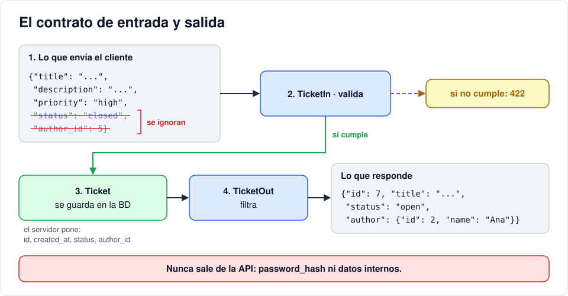

# Iteración 03 · CRUD de tickets

[← 02 · Base de datos y modelos](02-base-de-datos.md) · [Índice](README.md) · [04 · Registro, login y JWT →](04-registro-login-jwt.md) <!-- nav -->

**Clase:** martes 20 de octubre · **Entra en:** parcial 1 · **Duración:** 45 min · **Temas del plan:** APIs REST, validación de datos.

## Lo que vas a construir

Las cuatro operaciones básicas sobre tickets (crear, leer, actualizar y borrar, lo que se conoce como **CRUD**), probadas desde `/docs`. Todavía sin login: eso llega en las iteraciones 04 y 05.

## Antes de programar

1. Cuando un usuario crea un ticket, ¿qué campos debe enviar él y qué campos debe poner el servidor? Haz dos listas.
2. Si el cliente envía `"priority": "urgentísima"`, ¿quién debería detectarlo y qué debería responder?
3. ¿Qué rutas y métodos usarías para listar, crear, cambiar el estado y borrar? Escríbelas antes de ver la tabla de abajo.

## Conceptos

### REST: recursos y métodos

Una API REST organiza las rutas alrededor de **recursos** (sustantivos) y usa el **método** HTTP para decir la acción (verbo):

| Método y ruta | Acción | Respuesta |
|---|---|---|
| `GET /api/tickets` | Listar | 200 + lista |
| `POST /api/tickets` | Crear | 201 + ticket creado |
| `PATCH /api/tickets/{id}` | Cambiar el estado | 200 + ticket actualizado |
| `DELETE /api/tickets/{id}` | Borrar | 204 sin cuerpo |

Fíjate que no hay rutas como `/crearTicket` o `/borrarTicket`: el verbo ya lo dice el método.

### Esquemas: el contrato de entrada y salida

Un **esquema** (con Pydantic) define la forma exacta de los datos que entran o salen. No es lo mismo que el modelo de la base de datos:

| | Modelo (`models.py`) | Esquema de entrada (`TicketIn`) | Esquema de salida (`TicketOut`) |
|---|---|---|---|
| Para qué | Guardar en la BD | Lo que el cliente **puede** enviar | Lo que el servidor **devuelve** |
| `id`, `created_at`, `status` | Sí | **No**: los pone el servidor | Sí |
| `author_id` | Sí | **No**: se saca del usuario autenticado | Se devuelve el autor resumido |

Separarlos evita dos problemas: que el cliente se invente datos que no le corresponden (por ejemplo, crear un ticket ya cerrado o a nombre de otro) y que el servidor devuelva datos internos (como el hash de una contraseña).

Si los datos no cumplen el esquema, FastAPI responde **422** automáticamente, con el detalle de qué campo falló. No escribes ni un `if` para eso.



### Inyección de dependencias

Cada petición necesita una sesión de base de datos que se abra al inicio y se cierre al final. En lugar de repetir ese código en cada función, la función **declara** lo que necesita y FastAPI se lo entrega:

```python
def list_tickets(db: Annotated[Session, Depends(get_db)]):
```

Se lee: "esta función necesita una `Session`, y se consigue llamando a `get_db`". FastAPI ejecuta `get_db` hasta el `yield`, le pasa la sesión a tu función y, cuando termina la respuesta, ejecuta el `finally` que la cierra. Para no repetir esa línea larga, la guardamos en un alias: `DB = Annotated[Session, Depends(get_db)]`.

## Paso a paso

### 1. Los esquemas

Crea `backend/app/schemas.py`:

```python
from datetime import datetime

from pydantic import BaseModel, ConfigDict, Field

from .models import Priority, TicketStatus


class ORM(BaseModel):
    # Permite construir el esquema a partir de un objeto de SQLAlchemy
    model_config = ConfigDict(from_attributes=True)


class AuthorOut(ORM):
    id: int
    name: str


class TicketIn(BaseModel):
    title: str = Field(min_length=1, max_length=120)
    description: str = Field(min_length=1)
    priority: Priority = Priority.medium


class TicketUpdate(BaseModel):
    status: TicketStatus


class TicketOut(ORM):
    id: int
    title: str
    description: str
    priority: Priority
    status: TicketStatus
    created_at: datetime
    author: AuthorOut
```

- `Field(max_length=120)` coincide con `String(120)` del modelo. Si no coincidieran, ¿qué error vería el usuario?
- `priority: Priority` acepta solo los valores del enum. Esa es la respuesta a la pregunta 2.
- `author: AuthorOut` devuelve solo `id` y `name` del autor, nunca su email ni su hash.

### 2. El router de tickets

Un **router** agrupa rutas relacionadas en un archivo. Crea `backend/app/routers/__init__.py` **vacío** y luego `backend/app/routers/tickets.py`:

```python
from typing import Annotated

from fastapi import APIRouter, Depends, HTTPException, Response, status
from sqlalchemy import select
from sqlalchemy.orm import Session

from ..database import get_db
from ..models import Ticket
from ..schemas import TicketIn, TicketOut, TicketUpdate

router = APIRouter(prefix="/tickets", tags=["tickets"])
DB = Annotated[Session, Depends(get_db)]

# TEMPORAL: mientras no hay login, todos los tickets quedan a nombre del admin (id 1).
# En la iteración 05 se reemplaza por el usuario autenticado.
TEMP_AUTHOR_ID = 1


@router.get("", response_model=list[TicketOut])
def list_tickets(db: DB):
    query = select(Ticket).order_by(Ticket.created_at.desc())
    return db.scalars(query).all()


@router.post("", response_model=TicketOut, status_code=status.HTTP_201_CREATED)
def create_ticket(data: TicketIn, db: DB):
    ticket = Ticket(**data.model_dump(), author_id=TEMP_AUTHOR_ID)
    db.add(ticket)
    db.commit()
    db.refresh(ticket)
    return ticket


@router.patch("/{ticket_id}", response_model=TicketOut)
def update_ticket(ticket_id: int, data: TicketUpdate, db: DB):
    ticket = db.get(Ticket, ticket_id)
    if not ticket:
        raise HTTPException(status.HTTP_404_NOT_FOUND, "Ticket no encontrado")
    ticket.status = data.status
    db.commit()
    db.refresh(ticket)
    return ticket


@router.delete("/{ticket_id}", status_code=status.HTTP_204_NO_CONTENT)
def delete_ticket(ticket_id: int, db: DB):
    ticket = db.get(Ticket, ticket_id)
    if not ticket:
        raise HTTPException(status.HTTP_404_NOT_FOUND, "Ticket no encontrado")
    db.delete(ticket)
    db.commit()
    return Response(status_code=status.HTTP_204_NO_CONTENT)
```

Línea por línea, lo nuevo:

- `data: TicketIn`: FastAPI lee el cuerpo JSON de la petición y lo valida contra `TicketIn`. Si llega a tu función, ya es válido.
- `ticket_id: int`: se llena con el `{ticket_id}` de la ruta. Si alguien pide `/tickets/abc`, responde 422 porque no es un entero.
- `response_model=TicketOut`: filtra la respuesta. Aunque retornes el objeto completo de la BD, solo salen los campos del esquema.
- `data.model_dump()` convierte el esquema en un diccionario, y `**` lo "desempaca" como argumentos: equivale a escribir `Ticket(title=..., description=..., priority=..., author_id=1)`.
- `db.add` → `db.commit` → `db.refresh`: agrega, confirma en la BD y vuelve a leer el objeto para traer lo que puso la base de datos (`id`, `created_at`).
- `raise HTTPException(...)`: corta la ejecución y responde con ese código y mensaje.

### 3. Conecta el router a la aplicación

En `backend/app/main.py`, cambia las importaciones de FastAPI y agrega la del router:

```python
from fastapi import APIRouter, FastAPI
# ...las demás importaciones se quedan igual...
from .routers import tickets
```

Y al final del archivo, después del endpoint `health`:

```python
api = APIRouter(prefix="/api")
api.include_router(tickets.router)
app.include_router(api)
```

El prefijo `/api` se suma al `/tickets` del router: la ruta final queda `/api/tickets`.

## Comprueba

Abre http://localhost:8000/docs. Debe aparecer la sección **tickets** con cuatro operaciones. Haz esto en orden y anota el código de estado de cada respuesta:

1. `POST /api/tickets` con `{"title": "No prende el PC", "description": "Sale pantalla negra", "priority": "high"}`. Esperado: **201**, con `id`, `status: "open"` y el autor *Admin*.
2. `GET /api/tickets`. Esperado: **200** y una lista con tu ticket.
3. `PATCH /api/tickets/1` con `{"status": "closed"}`. Esperado: **200**.
4. `PATCH /api/tickets/1` con `{"status": "terminado"}`. Esperado: **422**. Lee el mensaje de error: ¿qué te dice?
5. `POST` sin el campo `title`. Esperado: **422**.
6. `DELETE /api/tickets/999`. Esperado: **404**.

## Para pensar

- Intenta crear un ticket enviando también `"status": "closed"` y `"author_id": 5`. ¿Qué pasa con esos campos? ¿Por qué es bueno ese comportamiento?
- `DELETE` responde 204 y no 200. Con lo que viste en la iteración 01, ¿por qué tiene sentido? ¿Qué devolverías en el cuerpo si respondieras 200?
- **Reto:** agrega `GET /api/tickets/{ticket_id}` que devuelva un ticket o 404.

## Guarda tu avance

```bash
git add .
git commit -m "feat(api): CRUD de tickets"
```

---

[← 02 · Base de datos y modelos](02-base-de-datos.md) · [Índice](README.md) · [04 · Registro, login y JWT →](04-registro-login-jwt.md) <!-- nav -->
