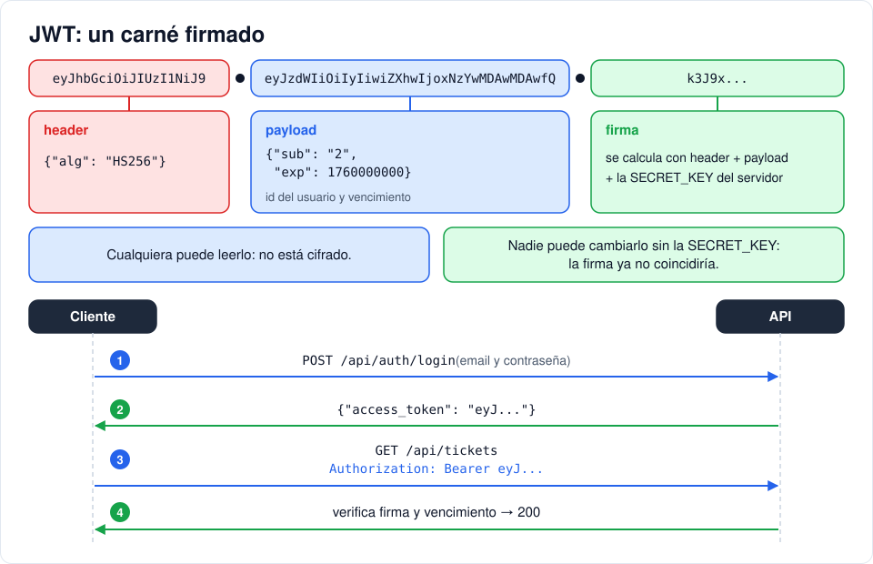

# Iteración 04 · Registro, login y JWT

[← 03 · CRUD de tickets](03-crud-tickets.md) · [Índice](README.md) · [05 · Proteger rutas y roles →](05-proteger-rutas-roles.md) <!-- nav -->

**Clase:** martes 20 de octubre · **Entra en:** parcial 1 · **Duración:** 45 min · **Temas del plan:** seguridad en sistemas web, HTTP.

## Lo que vas a construir

Dos endpoints: `POST /api/auth/register` para crear una cuenta y `POST /api/auth/login`, que devuelve un **token** que prueba quién eres.

## Antes de programar

1. HTTP no tiene memoria: cada petición llega sola, sin saber nada de las anteriores. Entonces, después de iniciar sesión, ¿cómo sabe el servidor que la siguiente petición es tuya?
2. Si el login falla, ¿le dirías al usuario "ese correo no existe" o "la contraseña está mal"? Piensa qué podría hacer un atacante con esa información.
3. Si el formulario de registro tuviera un campo `role`, ¿qué pasaría?

## Conceptos

### Autenticación

**Autenticar** es comprobar quién eres. El login lo hace una vez con correo y contraseña; a partir de ahí necesitamos algo que el cliente envíe en cada petición para no pedirle la contraseña cada vez. Ese algo es un **token**.

### JWT: un carné firmado

Un **JWT** (JSON Web Token) es un texto con tres partes separadas por puntos:



- **Header:** el algoritmo de firma (`HS256`).
- **Payload:** los datos. Aquí solo `sub` (el id del usuario) y `exp` (cuándo vence).
- **Firma:** se calcula con el header, el payload y una **clave secreta** que solo conoce el servidor.

Piénsalo como un carné de la universidad con un sello. Cualquiera puede **leer** el carné, pero nadie puede **falsificar** el sello. Si alguien cambia el `sub` de `2` a `1` para hacerse pasar por el admin, la firma ya no coincide y el servidor rechaza el token.

Dos consecuencias importantes:

- El payload **no está cifrado**, solo codificado. Nunca pongas ahí contraseñas ni datos sensibles.
- El servidor no guarda una lista de sesiones: le basta con verificar la firma. Por eso se dice que es *stateless* (sin estado).

### Por qué el token solo lleva el id

Podríamos meter el rol dentro del token, pero entonces, si un admin le quita el rol a alguien, esa persona seguiría con permisos hasta que su token venza. Guardando solo el id, el servidor consulta el rol y si la cuenta está activa **en cada petición**. Los cambios surten efecto de inmediato.

## Paso a paso

### 1. La clave secreta

Agrega al `.env`:

```env
# JWT: cambia SECRET_KEY en producción (openssl rand -hex 32)
SECRET_KEY=dev-only-change-me-7f3a9c1e5b2d4f60a8c3e1b9d7f5a2c4
ACCESS_TOKEN_EXPIRE_MINUTES=60
```

Agrega los dos campos a la clase `Settings` en `backend/app/config.py`:

```python
    secret_key: str
    access_token_expire_minutes: int = 60
```

Los contenedores leen el `.env` **cuando se crean**, no cuando reinician. Recréalo:

```bash
docker compose up -d --force-recreate api
```

### 2. Crear y verificar tokens

Reemplaza `backend/app/security.py`:

```python
from datetime import datetime, timedelta, timezone

import bcrypt
import jwt

from .config import settings

ALGORITHM = "HS256"


def hash_password(password: str) -> str:
    return bcrypt.hashpw(password.encode(), bcrypt.gensalt()).decode()


def verify_password(password: str, password_hash: str) -> bool:
    return bcrypt.checkpw(password.encode(), password_hash.encode())


def create_access_token(user_id: int) -> str:
    # Solo se guarda el id: el rol y el estado se leen de la BD en cada petición
    exp = datetime.now(timezone.utc) + timedelta(minutes=settings.access_token_expire_minutes)
    return jwt.encode({"sub": str(user_id), "exp": exp}, settings.secret_key, algorithm=ALGORITHM)


def decode_token(token: str) -> int | None:
    try:
        payload = jwt.decode(token, settings.secret_key, algorithms=[ALGORITHM])
        return int(payload["sub"])
    except (jwt.PyJWTError, KeyError, ValueError):
        return None
```

`jwt.decode` verifica la firma **y** la fecha de vencimiento. Si algo falla, lanza un error; nosotros lo convertimos en `None` para decir "token no válido" sin importar la razón.

### 3. Esquemas de usuario

En `backend/app/schemas.py`, cambia la importación de Pydantic y la de modelos:

```python
from pydantic import BaseModel, ConfigDict, EmailStr, Field

from .models import Priority, Role, TicketStatus
```

Y agrega estos esquemas debajo de la clase `ORM`:

```python
class RegisterIn(BaseModel):
    name: str = Field(min_length=1, max_length=100)
    email: EmailStr
    password: str = Field(min_length=8, max_length=72)  # bcrypt ignora más de 72 bytes


class LoginIn(BaseModel):
    email: EmailStr
    password: str


class UserOut(ORM):
    id: int
    name: str
    email: str
    role: Role
    is_active: bool


class TokenOut(BaseModel):
    access_token: str
    token_type: str = "bearer"
    user: UserOut
```

- `EmailStr` valida que sea un correo con formato real. Rechaza dominios reservados como `.local` o `.test`.
- `RegisterIn` **no tiene** `role`. Esa es la respuesta a la pregunta 3: si lo tuviera, cualquiera se registraría como admin.
- `UserOut` no tiene `password_hash`.

### 4. El router de autenticación

Crea `backend/app/routers/auth.py`:

```python
from typing import Annotated

from fastapi import APIRouter, Depends, HTTPException, status
from sqlalchemy import select
from sqlalchemy.orm import Session

from ..database import get_db
from ..models import Role, User
from ..schemas import LoginIn, RegisterIn, TokenOut, UserOut
from ..security import create_access_token, hash_password, verify_password

router = APIRouter(prefix="/auth", tags=["auth"])
DB = Annotated[Session, Depends(get_db)]

# Hash falso para igualar el tiempo de respuesta cuando el email no existe
_DUMMY_HASH = hash_password("dummy-password")


@router.post("/register", response_model=UserOut, status_code=status.HTTP_201_CREATED)
def register(data: RegisterIn, db: DB):
    email = data.email.lower()
    if db.scalar(select(User).where(User.email == email)):
        raise HTTPException(status.HTTP_409_CONFLICT, "Email ya registrado")
    # El rol nunca viene del cliente: el autorregistro siempre crea un "user"
    user = User(name=data.name, email=email, password_hash=hash_password(data.password), role=Role.user)
    db.add(user)
    db.commit()
    return user


@router.post("/login", response_model=TokenOut)
def login(data: LoginIn, db: DB):
    user = db.scalar(select(User).where(User.email == data.email.lower()))
    valid = verify_password(data.password, user.password_hash if user else _DUMMY_HASH)
    if not user or not valid or not user.is_active:
        raise HTTPException(status.HTTP_401_UNAUTHORIZED, "Credenciales incorrectas")
    return TokenOut(access_token=create_access_token(user.id), user=user)
```

Tres decisiones de seguridad para que las identifiques:

1. **El correo se guarda en minúsculas.** Sin esto, `Ana@x.com` y `ana@x.com` serían dos cuentas distintas.
2. **El mismo mensaje para correo inexistente y contraseña incorrecta.** Si el mensaje fuera distinto, un atacante podría averiguar qué correos están registrados.
3. **El hash falso.** bcrypt es lento a propósito. Si el correo no existe y respondiéramos de una vez, la respuesta sería más rápida, y midiendo tiempos se podría saber igual qué correos existen. Comparando contra un hash falso, las dos respuestas tardan lo mismo.

### 5. Conecta el router

En `backend/app/main.py`:

```python
from .routers import auth, tickets
```

```python
api.include_router(auth.router)
api.include_router(tickets.router)
```

## Comprueba

En http://localhost:8000/docs, sección **auth**:

1. `register` con `{"name": "Ana", "email": "ana@correo.com", "password": "ana12345"}`. Esperado: **201** con rol `user` y sin contraseña en la respuesta.
2. Repite exactamente el mismo registro. Esperado: **409**.
3. `register` con contraseña de 5 caracteres. Esperado: **422**.
4. `login` con contraseña incorrecta. Esperado: **401**. Luego con un correo que no existe: ¿el mensaje es igual?
5. `login` correcto. Esperado: **200** con `access_token` y los datos del usuario.

Ahora mira por dentro el token. Copia la parte del medio (entre el primer y el segundo punto), abre la consola del navegador (F12, pestaña **Console**) y escribe:

```js
JSON.parse(atob("PEGA_AQUI_LA_PARTE_DEL_MEDIO"))
```

Verás `sub` y `exp`. Cualquiera puede leerlo sin la clave secreta: por eso no se guardan datos sensibles ahí. (Si `atob` da error, reemplaza los `-` por `+` y los `_` por `/`.)

## Para pensar

- Ana se registra con `Ana@Correo.com` y luego intenta entrar con `ana@correo.com`. ¿Puede? ¿Qué línea lo hace posible?
- `exp` es un número como `1760000000`. ¿Qué crees que representa? Pista: `new Date(1760000000 * 1000)` en la consola.
- ¿Qué pasaría con todos los tokens ya emitidos si cambias la `SECRET_KEY` y recreas la API?

## Guarda tu avance

```bash
git add .
git commit -m "feat(api): registro y login con JWT"
```

---

[← 03 · CRUD de tickets](03-crud-tickets.md) · [Índice](README.md) · [05 · Proteger rutas y roles →](05-proteger-rutas-roles.md) <!-- nav -->
