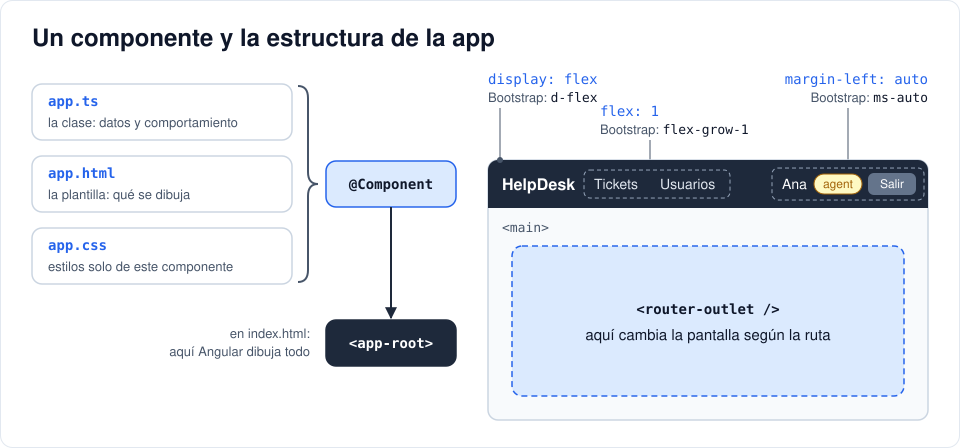

# Iteración 06 · Esqueleto en Angular

[← 05 · Proteger rutas y roles](05-proteger-rutas-roles.md) · [Índice](README.md) · [Tarea · JavaScript mínimo para Angular →](06b-javascript-minimo.md) <!-- nav -->

**Clase:** martes 27 de octubre · **Entra en:** parcial 1 · **Duración:** 45 min · **Temas del plan:** HTML5 semántico, SEO, cascada, Flexbox, meta-frameworks y estrategias de renderizado.

## Lo que vas a construir

El proyecto de Angular con la estructura visual de la aplicación: una barra superior con el nombre, el menú y la sesión, y un área principal donde después aparecerán las pantallas.

## Antes de programar

1. Abre Gmail o cualquier aplicación web que uses a diario y navega entre secciones. ¿La página completa se recarga (la pantalla parpadea en blanco) o solo cambia una parte?
2. Mira la aplicación terminada (la carpeta `frontend` del repositorio de referencia o la imagen que muestre tu profesor). Dibuja en papel sus partes grandes: ¿qué se repite en todas las pantallas y qué cambia?

## Conceptos

### SPA: una sola página que cambia por dentro

En un sitio tradicional, cada clic pide al servidor una página HTML nueva. En una **SPA** (*Single Page Application*) el navegador descarga una sola vez la aplicación en JavaScript y, a partir de ahí, solo pide **datos** (JSON) y redibuja la parte que cambia. Por eso se siente más rápida.

### Dónde se arma el HTML: CSR, SSR y SSG

| Estrategia | Dónde se genera el HTML | Bueno para |
|---|---|---|
| **CSR** (*Client-Side Rendering*) | En el navegador, con JavaScript | Aplicaciones detrás de un login (paneles, sistemas internos) |
| **SSR** (*Server-Side Rendering*) | En el servidor, en cada petición | Páginas públicas que deben aparecer en Google y cargar rápido |
| **SSG** (*Static Site Generation*) | En el servidor, una sola vez al compilar | Blogs, documentación, páginas que casi no cambian |

HelpDesk usa **CSR**: todo está detrás de un login, así que a Google no le interesa, y no necesitamos un servidor extra para generar HTML. Por eso creamos el proyecto con `--ssr=false`. Angular, Next.js (React) y Nuxt (Vue) soportan las tres estrategias; lo que cambia es la sintaxis.

### Qué es un componente

Un **componente** es una pieza de interfaz con tres partes:

| Archivo | Qué contiene |
|---|---|
| `app.ts` | La clase: datos y comportamiento |
| `app.html` | La plantilla: qué se dibuja |
| `app.css` | Los estilos, que **solo** afectan a este componente |

El decorador `@Component` une las tres partes y define el `selector`, la etiqueta HTML con la que se usa el componente: `<app-root>`.



### Angular y React: mismos conceptos, distinta sintaxis

El plan de estudio menciona React. Esta tabla te sirve para traducir lo que aprendas aquí:

| Concepto | Angular | React |
|---|---|---|
| Componente | Clase con `@Component` + plantilla HTML | Función que retorna JSX |
| Estado | `signal()` | `useState()` |
| Valor derivado | `computed()` | `useMemo()` o cálculo directo |
| Código al crear el componente | `constructor` / `ngOnInit` | `useEffect(() => {}, [])` |
| Cómo actualiza la pantalla | Plantillas compiladas + signals avisan qué cambió | DOM virtual: compara versiones y aplica diferencias |
| Meta-framework con SSR | Angular SSR (integrado) | Next.js |

### HTML semántico: un repaso con propósito

Ya conoces HTML. Lo nuevo aquí es usar la etiqueta que **dice qué es** cada parte: `<header>`, `<nav>`, `<main>`, `<button>`. Un `<div>` no dice nada. Los lectores de pantalla (que usan personas con discapacidad visual) y los buscadores (SEO) se guían por esas etiquetas, por el idioma (`lang="es"`), el título y la descripción del documento.

### De Bootstrap a CSS propio

En este proyecto no usamos Bootstrap. No porque esté mal, sino porque Bootstrap es CSS que alguien más escribió, y ahora vas a ver qué hay debajo de las clases que ya conoces. Cuando entiendas esto, vas a usar Bootstrap (o Tailwind) sabiendo qué hace cada clase.

Casi todas las clases de diseño de Bootstrap son **Flexbox**. Compara:

| Bootstrap | CSS que hay detrás | Qué hace |
|---|---|---|
| `d-flex` | `display: flex` | Los hijos se ponen en fila |
| `flex-column` | `flex-direction: column` | Los hijos se ponen en columna |
| `align-items-center` | `align-items: center` | Centra los hijos en vertical |
| `gap-4` | `gap: 1.5rem` (24 px) | Espacio entre hijos |
| `flex-grow-1` | `flex-grow: 1` (nosotros usamos `flex: 1`, casi igual) | Este hijo ocupa todo el espacio que sobre |
| `ms-auto` | `margin-left: auto` | Empuja este hijo hasta el extremo derecho |

Y los componentes de Bootstrap que usaste tienen su versión casera en el `styles.css` que vas a escribir hoy: `.card` es la tarjeta, `.badge` la etiqueta de color, `button.danger` hace lo mismo que `btn btn-danger`.

### La cascada y los estilos por componente

Cuando varias reglas afectan al mismo elemento, gana la más **específica** y, si empatan, la que aparece **de última**. Por eso, cuando tu CSS "no hacía nada" encima de Bootstrap, casi siempre era que la regla de Bootstrap era más específica.

En Angular hay dos niveles de estilos:

- `src/styles.css`: estilos **globales**, para toda la aplicación (botones, tarjetas, tablas). Es el equivalente a incluir Bootstrap.
- El `.css` de cada componente: Angular lo **encapsula**, así que una regla `header {}` en `app.css` no afecta a ningún otro componente. Esto no existe en un sitio con HTML y CSS normales.

## Paso a paso

### 1. Crea el proyecto

Desde la raíz de `helpdesk/`:

```bash
npx @angular/cli@latest new frontend --style=css --ssr=false --skip-git --ai-config=none
```

- `--ssr=false`: CSR, como explicamos arriba.
- `--skip-git`: tu repositorio ya existe en la carpeta de arriba. Sin esta opción, Angular crearía un repositorio dentro de otro.

Tarda un par de minutos porque descarga las dependencias. Luego:

```bash
cd frontend
npx ng serve
```

Abre http://localhost:4200. Verás la página de bienvenida de Angular. Deja `ng serve` corriendo: cada vez que guardes un archivo, el navegador se actualiza solo.

### 2. Recorre lo que se generó

No modifiques nada todavía; solo abre cada archivo y ubica lo siguiente:

| Archivo | Qué es |
|---|---|
| `src/index.html` | La única página HTML. Fíjate en `<app-root>`: ahí Angular dibuja todo. |
| `src/main.ts` | El punto de entrada: arranca la aplicación con el componente `App`. |
| `src/app/app.config.ts` | Configuración global (rutas, HTTP, etc.). |
| `src/app/app.ts`, `.html`, `.css` | El componente raíz. |
| `src/app/app.routes.ts` | La lista de rutas. Por ahora vacía. |
| `src/styles.css` | Estilos globales. |

### 3. Idioma, título y descripción

En `src/index.html`, cambia `lang="en"` por `lang="es"`, cambia el título y agrega la descripción debajo del `<title>`:

```html
<html lang="es">
<head>
  <meta charset="utf-8">
  <title>HelpDesk</title>
  <meta name="description" content="Sistema de tickets de soporte">
```

### 4. Estilos globales

Reemplaza `src/styles.css`:

```css
* { box-sizing: border-box; }
body { margin: 0; font-family: system-ui, sans-serif; background: #f1f5f9; color: #0f172a; }
h1, h2 { margin-top: 0; }
.card { background: #fff; border-radius: 8px; padding: 20px; box-shadow: 0 1px 3px rgba(0,0,0,.1); margin-bottom: 16px; }
form { display: flex; flex-direction: column; gap: 12px; }
label { display: flex; flex-direction: column; gap: 4px; font-size: .9rem; font-weight: 500; }
input, select, textarea { padding: 8px 10px; border: 1px solid #cbd5e1; border-radius: 6px; font: inherit; }
button { padding: 8px 14px; border: 0; border-radius: 6px; background: #2563eb; color: #fff; font: inherit; cursor: pointer; }
button:disabled { opacity: .5; cursor: not-allowed; }
button.secondary { background: #475569; }
button.danger { background: #dc2626; }
.error { color: #b91c1c; font-size: .9rem; }
table { width: 100%; border-collapse: collapse; }
th, td { text-align: left; padding: 8px; border-bottom: 1px solid #e2e8f0; }
.badge { padding: 2px 8px; border-radius: 999px; font-size: .75rem; background: #e2e8f0; color: #0f172a; }
.badge.admin, .badge.high { background: #fecaca; }
.badge.agent, .badge.medium, .badge.in_progress { background: #fde68a; }
.badge.user, .badge.low, .badge.closed { background: #bbf7d0; }
.badge.open { background: #bfdbfe; }
```

- `box-sizing: border-box` hace que el `padding` y el borde queden **dentro** del ancho que declaras. Sin esto, un input de `width: 100%` con padding se sale de su contenedor.
- `.badge.high` (dos clases) es más específica que `.badge` (una clase), por eso su color gana. Así se pinta cada etiqueta según la prioridad, el estado o el rol.
- Fíjate que `form` y `label` usan `flex-direction: column` para apilar los campos.

### 5. El componente raíz

Reemplaza `src/app/app.ts`:

```ts
import { Component } from '@angular/core';
import { RouterOutlet } from '@angular/router';

@Component({
  imports: [RouterOutlet],
  selector: 'app-root',
  styleUrl: './app.css',
  templateUrl: './app.html',
})
export class App {
  protected readonly appName = 'HelpDesk';
}
```

Reemplaza **todo** el contenido de `src/app/app.html`:

```html
<header>
  <a class="brand" href="/">{{ appName }}</a>
  <nav>
    <a href="/tickets">Tickets</a>
    <a href="/users">Usuarios</a>
  </nav>
  <div class="session">
    <span>Invitado</span>
    <button class="secondary">Salir</button>
  </div>
</header>
<main>
  <router-outlet />
</main>
```

- `{{ appName }}` es **interpolación**: muestra el valor de una propiedad de la clase. Si cambias `appName` en el `.ts`, cambia en pantalla.
- `<router-outlet />` es el hueco donde Angular pintará la pantalla de la ruta actual. Como todavía no hay rutas, queda vacío.
- `protected` significa que la propiedad se puede usar en la plantilla, pero no desde otros archivos.
- Los enlaces usan `href` por ahora. En la iteración 08 vas a ver por qué hay que cambiarlos.

Reemplaza `src/app/app.css`:

```css
header { display: flex; align-items: center; gap: 24px; padding: 12px 24px; background: #1e293b; color: #fff; }
header a { color: #cbd5e1; text-decoration: none; }
header a.active, header a:hover { color: #fff; }
.brand { font-weight: 700; font-size: 1.1rem; color: #fff !important; }
nav { display: flex; gap: 16px; flex: 1; }
.session { display: flex; align-items: center; gap: 12px; margin-left: auto; }
main { max-width: 960px; margin: 24px auto; padding: 0 16px; }
```

`main` con `max-width` y `margin: 24px auto` centra el contenido y evita que en pantallas grandes las líneas queden larguísimas.

## Comprueba

- La barra superior oscura muestra **HelpDesk** a la izquierda, el menú en el medio y *Invitado* + *Salir* a la derecha.
- Haz clic derecho sobre la barra → **Inspeccionar**. En el panel de estilos, busca la regla `header` y desmarca `display: flex`. ¿Qué pasa? Vuelve a marcarla.
- En el inspector, fíjate que los elementos tienen atributos raros como `_ngcontent-abc-c12`. Así encapsula Angular los estilos de cada componente.
- La pestaña del navegador dice **HelpDesk**.

## Para pensar

- Quita `flex: 1` de `nav` en `app.css`. ¿Cambia algo? ¿Por qué el `margin-left: auto` de `.session` sigue empujándola a la derecha?
- **Reto (mobile-first):** pon el navegador en modo celular (F12 → ícono de celular, ancho 375 px). La barra se ve apretada. En Bootstrap escribías `col-12 col-md-6`: una columna en celular y media pantalla desde el tamaño `md`. Eso es *mobile-first*: primero los estilos para pantallas pequeñas y luego, para las grandes, un `@media (min-width: 768px) { ... }` (768 px es justo el `md` de Bootstrap). Haz que en celular el encabezado se apile en columna y que desde 768 px vuelva a estar en fila. Pista: `flex-direction`.

## Guarda tu avance

Desde la raíz `helpdesk/`:

```bash
git add .
git commit -m "feat(web): proyecto Angular con estructura base"
```

## Antes del parcial 1 (martes 3 de noviembre)

Con esta iteración se cierra lo que entra en el parcial 1. Verifica que:

- `git log --oneline` muestra un commit por cada iteración, de la 00 a la 06.
- `docker compose up -d` levanta el backend y `/docs` responde.
- `npx ng serve` abre la aplicación con el encabezado.
- Puedes responder sin mirar las preguntas de *Antes de programar* y *Para pensar* de las iteraciones 00 a 06, sobre todo la tabla de códigos de estado de la 05.

Después del parcial, antes de la clase del 10 de noviembre, haz la tarea [JavaScript mínimo para Angular](06b-javascript-minimo.md). La iteración 07 arranca dando por hecho que la hiciste.

---

[← 05 · Proteger rutas y roles](05-proteger-rutas-roles.md) · [Índice](README.md) · [Tarea · JavaScript mínimo para Angular →](06b-javascript-minimo.md) <!-- nav -->
