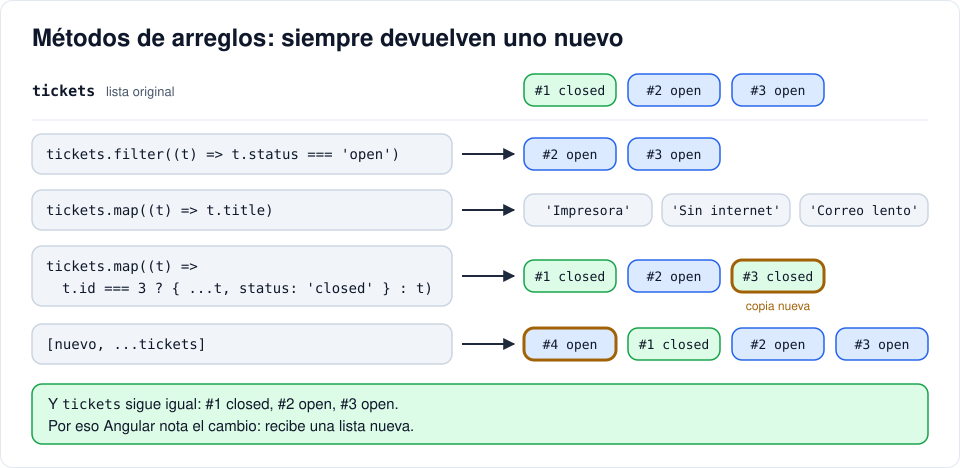

# Tarea · JavaScript mínimo para Angular

[← 06 · Esqueleto en Angular](06-angular-esqueleto.md) · [Índice](README.md) · [07 · TypeScript y señales →](07-typescript-senales.md) <!-- nav -->

**Clase:** tarea, antes del martes 10 de noviembre · **Entra en:** parcial 2 · **Duración:** 60 min · **Temas del plan:** programación funcional en JavaScript (ES6+), contextos de ejecución, modularidad.

## Para qué es esto

Ya sabes lo básico de JavaScript: variables, `if`, ciclos y funciones. El código de Angular usa todo el tiempo una forma más moderna de escribir JavaScript (la que se conoce como **ES6** o posterior). Si no la reconoces, vas a copiar sin entender, y en el parcial te van a pedir que expliques y modifiques ese código.

Aquí están **solo** las construcciones que aparecen en el proyecto, cada una con la iteración donde la vas a encontrar.

**Cómo hacerla:** abre cualquier página, oprime F12, ve a la pestaña **Console** y escribe cada ejemplo. No los pegues todos de una vez: escribe uno, mira el resultado y luego cámbialo para ver qué pasa. Al final hay un ejercicio que junta todo.

## 1. `const` y `let`

```js
const name = 'Ana';   // no se puede reasignar
let count = 0;        // sí se puede reasignar
count = count + 1;
name = 'Beto';        // error: Assignment to constant variable
```

Usa `const` por defecto y `let` solo si el valor va a cambiar. `var` ya no se usa.

Ojo: `const` impide **reasignar**, no impide **modificar por dentro**: `const list = []; list.push(1)` funciona.

## 2. Plantillas de texto (*template literals*)

Con comillas invertidas (`` ` ``) se pueden meter valores dentro del texto con `${...}`:

```js
const id = 7;
'Ticket #' + id + ' creado'    // forma vieja
`Ticket #${id} creado`         // forma moderna: mismo resultado
```

**En el proyecto:** las URL de la API, `` `${this.url}/tickets/${id}` `` (iteración 12), y el token, `` `Bearer ${token}` `` (iteración 11).

## 3. Objetos, arreglos y JSON

```js
const ticket = { id: 1, title: 'Impresora', author: { id: 2, name: 'Ana' } };
ticket.title            // 'Impresora'
ticket.author.name      // 'Ana'

const tickets = [ticket, { id: 2, title: 'Sin internet' }];
tickets.length          // 2
tickets[1].title        // 'Sin internet'
```

**JSON** es la forma de escribir objetos como texto, para enviarlos por la red o guardarlos:

```js
const text = JSON.stringify(ticket);   // objeto → texto
typeof text                            // 'string'
const back = JSON.parse(text);         // texto → objeto
back.author.name                       // 'Ana'
```

**En el proyecto:** la API responde JSON (iteración 09) y el usuario se guarda en el LocalStorage como texto (iteración 10).

## 4. Funciones flecha

Son una forma corta de escribir funciones:

```js
function double(n) { return n * 2; }   // forma tradicional
const double2 = (n) => n * 2;          // flecha: si es una sola expresión, se retorna sola
const add = (a, b) => a + b;
const greet = () => 'hola';            // sin parámetros
const big = (n) => {                   // con llaves, hay que escribir return
  const result = n * 100;
  return result;
};
```

**En el proyecto:** en todas partes. Las rutas, `() => import('./pages/login/login')` (iteración 08); las señales, `update((list) => [...])` (iteración 07).

## 5. Funciones como valores

En JavaScript una función se puede guardar en una variable, pasar como argumento o retornar desde otra función.

**Pasar una función** para que otra la ejecute después (un *callback*):

```js
setTimeout(() => console.log('pasaron 2 segundos'), 2000);
console.log('esto sale primero');
```

**Retornar una función** que "recuerda" los valores con los que se creó (una *clausura*):

```js
const multiplier = (factor) => (n) => n * factor;
const triple = multiplier(3);   // triple es una función que recuerda factor = 3
triple(5)                       // 15
```

**En el proyecto:** `subscribe({ next: (r) => ..., error: (e) => ... })` le pasa dos funciones a la petición para que las ejecute cuando llegue la respuesta (iteración 09). `roleGuard('admin')` es una función que retorna otra, igual que `multiplier` (iteración 11).

## 6. Métodos de arreglos

Ninguno modifica el arreglo original: todos devuelven algo nuevo. Cada uno recibe una función que se ejecuta con cada elemento.

```js
const nums = [1, 2, 3, 4];

nums.map((n) => n * 10)          // [10, 20, 30, 40]   transforma cada elemento
nums.filter((n) => n > 2)        // [3, 4]             deja los que cumplen
nums.find((n) => n > 2)          // 3                  el primero que cumple
nums.includes(3)                 // true               ¿está?
nums                             // [1, 2, 3, 4]       el original no cambió
```

**En el proyecto:** `filter` para quitar un ticket borrado y `map` para reemplazar uno modificado (iteraciones 07 y 12); `includes` para saber si el usuario tiene un rol (iteración 10).



## 7. Spread, rest y atajos de objetos

Los tres puntos `...` **esparcen** un arreglo u objeto dentro de otro:

```js
const a = [1, 2];
[0, ...a, 3]                         // [0, 1, 2, 3]

const t = { id: 1, status: 'open' };
const closed = { ...t, status: 'closed' };   // copia de t con un campo cambiado
t.status                                      // 'open': el original no cambió
```

En los parámetros de una función, los mismos tres puntos **recogen** todos los argumentos en un arreglo (se llama *rest*):

```js
const hasAny = (...roles) => roles.length;
hasAny('agent', 'admin')     // 2
```

Si la propiedad y la variable se llaman igual, no hace falta repetir:

```js
const email = 'ana@correo.com', password = 'ana12345';
{ email: email, password: password }   // forma larga
{ email, password }                    // atajo: lo mismo
```

**En el proyecto:** `[ticket, ...list]` (iteración 07), `hasRole(...roles)` (iteración 10), `{ email, password }` como cuerpo del login (iteración 09).

## 8. Verdadero, falso y operadores cortos

En una condición, estos valores cuentan como **falsos**: `false`, `0`, `''` (texto vacío), `null`, `undefined`. Todo lo demás cuenta como verdadero.

```js
!!'hola'       // true    !! convierte cualquier valor a true/false
!!null         // false

null || 'invitado'        // 'invitado'   || devuelve el primero que sea verdadero
'Ana' || 'invitado'       // 'Ana'
null ?? 'vacío'           // 'vacío'      ?? solo reemplaza null y undefined
0 ?? 10                   // 0            (con || daría 10)

const user = null;
user.name                 // error: Cannot read properties of null
user?.name                // undefined    ?. no falla si lo de la izquierda es null

const status = 401;
status === 401 ? 'Credenciales incorrectas' : 'Otro error'   // condicional en una línea
```

**En el proyecto:** `auth.user()?.name` en el encabezado y `?? 'null'` al leer el LocalStorage (iteración 10), `isLoggedIn() || createUrlTree(...)` en los guards (iteración 11), los mensajes de error con `? :` en el login (iteración 09).

## 9. Clases y `this`

Cada componente y cada servicio de Angular es una **clase**: un molde con datos (propiedades) y acciones (métodos). Dentro de la clase, `this` es "este objeto".

```js
class Counter {
  count = 0;              // propiedad

  increment() {           // método
    this.count = this.count + 1;
  }
}

const c = new Counter();  // crear un objeto a partir del molde
c.increment();
c.increment();
c.count                   // 2
```

**En el proyecto:** `this.tickets`, `this.loading.set(true)`, `this.auth.login(...)`. Si se te olvida el `this`, JavaScript busca una variable suelta con ese nombre y falla.

## 10. Módulos: `import` y `export`

Cada archivo es un **módulo**. Lo que un archivo quiere compartir lo marca con `export`, y otro archivo lo trae con `import`:

```js
// models.ts
export interface Ticket { /* ... */ }

// tickets.ts
import { Ticket } from '../../core/models';
```

La ruta es relativa al archivo donde se escribe el `import`: `../` sube una carpeta. Si se importa de un paquete instalado (`'@angular/core'`), va sin `./`.

Este ejemplo no se puede probar en la consola; lo vas a ver al inicio de todos los archivos `.ts` del proyecto.

## Ejercicio final

Pega esto en la consola:

```js
const tickets = [
  { id: 1, title: 'Impresora atascada', priority: 'low', status: 'closed' },
  { id: 2, title: 'Sin internet', priority: 'high', status: 'open' },
  { id: 3, title: 'Correo lento', priority: 'medium', status: 'open' },
];
```

Escribe una sola expresión para cada punto. Ninguna puede modificar `tickets`: al final, `tickets` debe seguir igual.

1. Un arreglo con los **títulos** de los tickets abiertos.
2. El ticket con `id` 2.
3. Un arreglo nuevo **sin** el ticket 1.
4. Un arreglo nuevo donde el ticket 3 quede cerrado y los demás igual.
5. Un arreglo nuevo con un ticket `{ id: 4, title: 'Teclado', priority: 'low', status: 'open' }` **al inicio**.
6. Una función `isOneOf` que se use así: `isOneOf('high', 'medium')('high')` → `true` y `isOneOf('high', 'medium')('low')` → `false`.
7. El texto `'Ticket #2: Sin internet'` construido a partir del objeto del punto 2.

<details>
<summary>Respuestas (para revisar después de intentarlo)</summary>

```js
tickets.filter((t) => t.status === 'open').map((t) => t.title)       // 1
tickets.find((t) => t.id === 2)                                       // 2
tickets.filter((t) => t.id !== 1)                                     // 3
tickets.map((t) => (t.id === 3 ? { ...t, status: 'closed' } : t))     // 4
[{ id: 4, title: 'Teclado', priority: 'low', status: 'open' }, ...tickets]   // 5
const isOneOf = (...values) => (x) => values.includes(x)              // 6
const t2 = tickets.find((t) => t.id === 2); `Ticket #${t2.id}: ${t2.title}`  // 7
```

Los puntos 3, 4 y 5 son exactamente lo que hacen `remove`, `setStatus` y `create` en la pantalla de tickets. El 6 es la misma idea de `roleGuard` y de `hasRole`.

</details>

## Para pensar

- En el punto 4, ¿por qué `{ ...t, status: 'closed' }` y no `t.status = 'closed'`? Revisa qué le pasa a `tickets` con cada opción.
- ¿Cuál es la diferencia entre `||` y `??`? Inventa un caso en el que den resultados distintos y que importe.

---

[← 06 · Esqueleto en Angular](06-angular-esqueleto.md) · [Índice](README.md) · [07 · TypeScript y señales →](07-typescript-senales.md) <!-- nav -->
