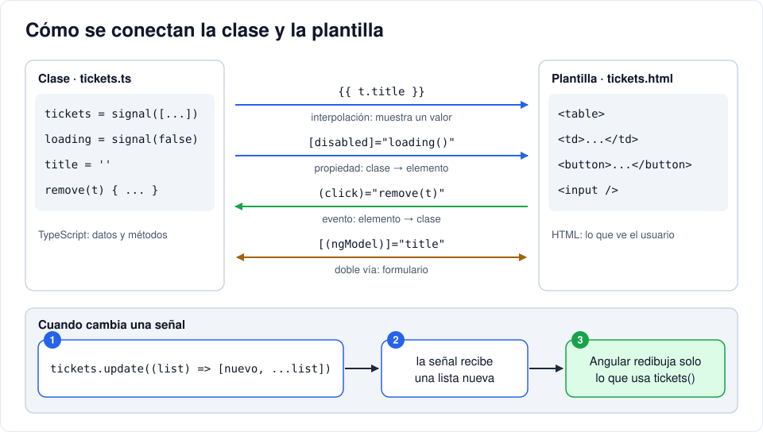

# Iteración 07 · TypeScript y señales

[← Tarea · JavaScript mínimo para Angular](06b-javascript-minimo.md) · [Índice](README.md) · [08 · Navegación con rutas →](08-rutas.md) <!-- nav -->

**Clase:** martes 10 de noviembre · **Entra en:** parcial 2 · **Duración:** 45 min · **Temas del plan:** TypeScript, programación funcional en JavaScript (ES6+), gestión del estado, CSS Grid.

> **Requisito:** haber hecho la tarea [JavaScript mínimo](06b-javascript-minimo.md). Aquí se usan [clases y `this`](06b-javascript-minimo.md#9-clases-y-this), [funciones flecha](06b-javascript-minimo.md#4-funciones-flecha), [métodos de arreglos](06b-javascript-minimo.md#6-métodos-de-arreglos), [spread y rest](06b-javascript-minimo.md#7-spread-rest-y-atajos-de-objetos), [módulos](06b-javascript-minimo.md#10-módulos-import-y-export).

## Lo que vas a construir

La pantalla de tickets funcionando **con datos de prueba en memoria**: una tabla que lista tickets, un formulario para agregar y un botón para borrar. Todavía no hablamos con el backend; primero entendemos cómo Angular muestra y actualiza datos.

## Antes de programar

1. Abre `backend/app/schemas.py` y mira `TicketOut`. Escribe en papel cómo se vería **un ticket** en JSON tal como lo devuelve la API.
2. Para dibujar la tabla, ¿qué datos necesita la pantalla? ¿Y para el formulario?
3. Cuando agregas un ticket, ¿qué tiene que pasar para que la tabla se actualice sola?

## Conceptos

### TypeScript: JavaScript con tipos

TypeScript es JavaScript más **tipos**. Los tipos no existen cuando el código corre en el navegador: se revisan al compilar y desaparecen. Su trabajo es avisarte de errores **antes** de que lleguen al usuario.

```ts
let count: number = 3;            // anotación explícita
let name = 'Ana';                 // inferido: TypeScript deduce que es string
type Priority = 'low' | 'medium' | 'high';   // unión: solo uno de estos tres textos

interface Ticket {                // la forma que debe tener un objeto
  id: number;
  title: string;
  priority: Priority;
}

const t: Ticket = { id: 1, title: 'PC', priority: 'urgente' };
//                                      ^^^^^^^^^ error al compilar: 'urgente' no es Priority
```

La interfaz `Ticket` es el **contrato** con el backend: debe coincidir con `TicketOut`. Si el backend cambia un campo y el frontend no, TypeScript te lo señala en todos los lugares donde se usa.

### Señales: estado que avisa cuando cambia

El **estado** de un componente son los datos que, si cambian, deben cambiar la pantalla. En Angular el estado se guarda en **signals**:

```ts
count = signal(0);         // crear con un valor inicial

this.count();              // leer: se llama como una función
this.count.set(5);         // reemplazar el valor
this.count.update((n) => n + 1);   // calcular el nuevo valor a partir del anterior
```

Cuando una señal cambia, Angular sabe exactamente qué partes de la plantilla la usan y solo redibuja esas.

### Inmutabilidad: crear en lugar de modificar

Para que Angular note un cambio en una lista, hay que darle una **lista nueva**, no modificar la que ya tiene. Para eso se usan estas herramientas de JavaScript moderno (ES6+), que no modifican el original sino que devuelven uno nuevo:

```ts
const list = [a, b, c];

[nuevo, ...list]                    // spread: lista nueva con 'nuevo' al inicio
list.filter((x) => x.id !== 2)      // lista nueva sin el elemento de id 2
list.map((x) => x.id === 2 ? cambiado : x)   // lista nueva con el elemento 2 reemplazado
```

`(x) => ...` es una **función flecha**: una forma corta de escribir una función. Pasar funciones como argumento a otras funciones (como a `filter` y `map`) es la base de la **programación funcional**.

### Sintaxis de las plantillas

| Sintaxis | Dirección | Ejemplo |
|---|---|---|
| `{{ valor }}` | Clase → pantalla (texto) | `{{ t.title }}` |
| `[propiedad]="valor"` | Clase → pantalla (propiedad de un elemento) | `[disabled]="loading()"` |
| `(evento)="metodo()"` | Pantalla → clase | `(click)="remove(t)"` |
| `[(ngModel)]="campo"` | En las dos direcciones | `[(ngModel)]="title"` |
| `@if (cond) { } @else { }` | Mostrar u ocultar | |
| `@for (x of lista; track x.id) { } @empty { }` | Repetir por cada elemento; `@empty` si la lista está vacía | |
| `{{ valor \| date: 'short' }}` | **Pipe**: transforma un valor para mostrarlo | Fecha ISO → `10/10/26, 9:30 AM` |

`track x.id` le dice a Angular cómo reconocer cada elemento. Así, si agregas un ticket, no redibuja toda la tabla, solo la fila nueva.



## Paso a paso

### 1. Los modelos

Crea la carpeta `src/app/core/` y dentro el archivo `models.ts`:

```ts
export type Role = 'user' | 'agent' | 'admin';
export type TicketStatus = 'open' | 'in_progress' | 'closed';
export type Priority = 'low' | 'medium' | 'high';

export interface User {
  id: number;
  name: string;
  email: string;
  role: Role;
  is_active: boolean;
}

export interface LoginResponse {
  access_token: string;
  token_type: string;
  user: User;
}

export interface Ticket {
  id: number;
  title: string;
  description: string;
  priority: Priority;
  status: TicketStatus;
  created_at: string;
  author: { id: number; name: string };
}
```

Compara cada interfaz con su esquema en `schemas.py`: `User` con `UserOut`, `LoginResponse` con `TokenOut`, `Ticket` con `TicketOut`. `created_at` es `string` porque en JSON las fechas viajan como texto.

### 2. Genera el componente

Desde la carpeta `frontend/`:

```bash
npx ng generate component pages/tickets
```

Crea `src/app/pages/tickets/` con `tickets.ts`, `tickets.html`, `tickets.css` y `tickets.spec.ts` (una prueba; la verás en la iteración 14).

### 3. La clase

Reemplaza `src/app/pages/tickets/tickets.ts`:

```ts
import { DatePipe } from '@angular/common';
import { Component, signal } from '@angular/core';
import { FormsModule } from '@angular/forms';
import { Priority, Ticket } from '../../core/models';

// TEMPORAL: datos de prueba. En la iteración 12 vienen del backend.
const MOCK_TICKETS: Ticket[] = [
  {
    id: 2,
    title: 'Sin internet en la sala 3',
    description: 'Ningún equipo tiene conexión',
    priority: 'high',
    status: 'open',
    created_at: '2026-10-10T14:30:00Z',
    author: { id: 2, name: 'Ana' },
  },
  {
    id: 1,
    title: 'Impresora atascada',
    description: 'Las hojas salen arrugadas',
    priority: 'low',
    status: 'closed',
    created_at: '2026-10-09T09:15:00Z',
    author: { id: 3, name: 'Beto' },
  },
];

@Component({
  imports: [FormsModule, DatePipe],
  selector: 'app-tickets',
  styleUrl: './tickets.css',
  templateUrl: './tickets.html',
})
export class Tickets {
  tickets = signal<Ticket[]>(MOCK_TICKETS);

  title = '';
  description = '';
  priority: Priority = 'medium';

  create() {
    const ticket: Ticket = {
      id: Date.now(), // TEMPORAL: el id real lo pondrá la base de datos
      title: this.title,
      description: this.description,
      priority: this.priority,
      status: 'open',
      created_at: new Date().toISOString(),
      author: { id: 0, name: 'Yo' },
    };
    this.tickets.update((list) => [ticket, ...list]);
    this.title = this.description = '';
    this.priority = 'medium';
  }

  remove(t: Ticket) {
    this.tickets.update((list) => list.filter((x) => x.id !== t.id));
  }
}
```

- `imports: [FormsModule, DatePipe]`: un componente solo puede usar en su plantilla lo que importa. `FormsModule` trae `ngModel`; `DatePipe`, el pipe `date`.
- `tickets` es una señal porque la tabla depende de ella. `title`, `description` y `priority` son propiedades normales porque `ngModel` se encarga de sincronizarlas con los campos del formulario.

### 4. La plantilla

Reemplaza `src/app/pages/tickets/tickets.html`:

```html
<h1>Tickets ({{ tickets().length }})</h1>

<div class="card">
  <h2>Nuevo ticket</h2>
  <form (ngSubmit)="create()">
    <label>Título <input name="title" [(ngModel)]="title" required maxlength="120" /></label>
    <label>
      Descripción
      <textarea name="description" rows="3" [(ngModel)]="description" required></textarea>
    </label>
    <label>
      Prioridad
      <select name="priority" [(ngModel)]="priority">
        <option value="low">Baja</option>
        <option value="medium">Media</option>
        <option value="high">Alta</option>
      </select>
    </label>
    <button>Crear ticket</button>
  </form>
</div>

<div class="card">
  <table>
    <thead>
      <tr>
        <th>#</th>
        <th>Título</th>
        <th>Autor</th>
        <th>Prioridad</th>
        <th>Estado</th>
        <th>Fecha</th>
        <th></th>
      </tr>
    </thead>
    <tbody>
      @for (t of tickets(); track t.id) {
        <tr>
          <td>{{ t.id }}</td>
          <td>
            <strong>{{ t.title }}</strong><br />
            <small class="ticket-desc">{{ t.description }}</small>
          </td>
          <td>{{ t.author.name }}</td>
          <td><span class="badge {{ t.priority }}">{{ t.priority }}</span></td>
          <td><span class="badge {{ t.status }}">{{ t.status }}</span></td>
          <td>{{ t.created_at | date: 'short' }}</td>
          <td><button class="danger" (click)="remove(t)">Borrar</button></td>
        </tr>
      } @empty {
        <tr>
          <td colspan="7">No hay tickets.</td>
        </tr>
      }
    </tbody>
  </table>
</div>
```

- `(ngSubmit)="create()"`: se ejecuta al oprimir el botón o al dar Enter en un campo. Un `<button>` dentro de un `<form>` envía el formulario por defecto.
- `name="title"`: `ngModel` dentro de un `<form>` necesita el atributo `name` para registrar el campo. Si lo quitas, Angular muestra un error en la consola.
- `class="badge {{ t.priority }}"` produce, por ejemplo, `class="badge high"`, y el CSS global de la iteración 06 le da el color.

Reemplaza `src/app/pages/tickets/tickets.css`:

```css
.ticket-desc {
  color: #64748b;
}
```

### 5. Muéstralo (temporalmente)

Para ver el componente sin rutas todavía, úsalo directamente dentro de `App`. En `src/app/app.ts`:

```ts
import { Tickets } from './pages/tickets/tickets';
```

```ts
  imports: [RouterOutlet, Tickets],
```

Y en `src/app/app.html`, dentro de `<main>`, debajo del `<router-outlet />`:

```html
  <app-tickets />
```

`<app-tickets />` es el `selector` del componente. Así se componen las interfaces: componentes dentro de componentes.

## Comprueba

- Se ven los dos tickets de prueba, con colores distintos en prioridad y estado, y el título dice **Tickets (2)**.
- Crea un ticket: aparece de primero, el contador sube y el formulario se limpia.
- Borra un ticket: desaparece. Borra todos: aparece *No hay tickets.*
- En `tickets.ts`, cambia la prioridad del primer ticket de prueba a `'urgente'` y guarda. La terminal de `ng serve` muestra un error de compilación: lee qué dice y en qué línea. Luego déjalo como estaba.
- Recarga la página: los tickets que creaste desaparecen. ¿Por qué? (La respuesta llega en la iteración 12.)

## Para pensar

- Un compañero escribe `this.tickets().unshift(ticket)` en lugar de `this.tickets.update(...)`. `unshift` mete el ticket en la **misma** lista. ¿Cómo se entera la señal de que algo cambió si nadie llamó a `set` ni a `update`? Explícale por qué es un error aunque a veces parezca funcionar.
- **Reto:** agrega un botón **Cerrar** en cada fila que cambie el estado del ticket a `closed`. Usa `update` y `map`. Pista: `{ ...x, status: 'closed' }` crea una copia de `x` con un campo cambiado.
- **Reto (CSS Grid):** la "grilla" de Bootstrap (`row` y `col-*`) en realidad está hecha con Flexbox, que reparte en **una** dirección. **CSS Grid** es otra cosa: organiza en filas **y** columnas a la vez, sin clases extra en cada hijo. En `tickets.css`, haz que el formulario quede en dos columnas: título y prioridad lado a lado, y la descripción y el botón ocupando todo el ancho. Pistas: `display: grid`, `grid-template-columns: 2fr 1fr` y `grid-column: 1 / -1`. Necesitarás un selector más específico que el `form` global, como `.card form`.

## Guarda tu avance

```bash
git add .
git commit -m "feat(web): pantalla de tickets con datos de prueba y signals"
```

---

[← Tarea · JavaScript mínimo para Angular](06b-javascript-minimo.md) · [Índice](README.md) · [08 · Navegación con rutas →](08-rutas.md) <!-- nav -->
