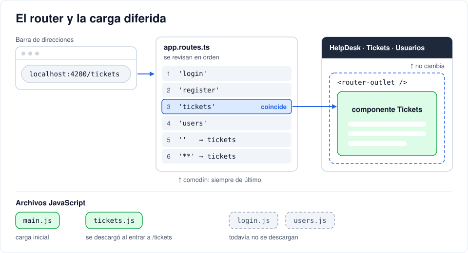

# Iteración 08 · Navegación con rutas

[← 07 · TypeScript y señales](07-typescript-senales.md) · [Índice](README.md) · [09 · Login contra la API →](09-http-login-cors.md) <!-- nav -->

**Clase:** martes 10 de noviembre · **Entra en:** parcial 2 · **Duración:** 35 min · **Temas del plan:** SPA, rendimiento y velocidad de carga.

> **JavaScript que vas a ver aquí:** [funciones flecha](06b-javascript-minimo.md#4-funciones-flecha), [módulos](06b-javascript-minimo.md#10-módulos-import-y-export). Si algo no lo reconoces, repásalo en la tarea [JavaScript mínimo](06b-javascript-minimo.md) antes de seguir.

## Lo que vas a construir

Cuatro pantallas (login, registro, tickets y usuarios) con su propia dirección (`/login`, `/tickets`, ...), un menú que navega entre ellas sin recargar la página y que solo descarga el código de cada pantalla cuando se necesita.

## Antes de programar

1. Escribe la lista de pantallas de la aplicación y la dirección (URL) que tendría cada una.
2. ¿Qué debería pasar si alguien escribe a mano una dirección que no existe, como `/hola`?
3. Si la aplicación tuviera 50 pantallas, ¿tiene sentido que el navegador descargue el código de las 50 al abrir el login?

## Conceptos

### El router

El **router** relaciona direcciones con componentes. Cuando la URL cambia, busca en la lista de rutas cuál coincide y pinta ese componente dentro de `<router-outlet />`. El encabezado, que está fuera del outlet, no se toca.

Las rutas se revisan **en orden** y gana la primera que coincide. Por eso el comodín `**` (cualquier cosa) va de último: si estuviera de primero, capturaría todas las direcciones.

### `href` vs `routerLink`

- `<a href="/tickets">`: el navegador pide una página nueva al servidor. Se recarga **toda** la aplicación.
- `<a routerLink="/tickets">`: Angular intercepta el clic, cambia la URL y cambia el componente. No se recarga nada.

### Carga diferida (*lazy loading*)

Con `loadComponent: () => import('./pages/login/login')`, el código del login se empaqueta en un archivo aparte (un *chunk*) que solo se descarga la primera vez que alguien entra a `/login`. La carga inicial es más liviana y la aplicación abre más rápido, sobre todo en celulares con mala señal.

`import()` devuelve una **promesa**: un valor que llegará más adelante. Lo verás en detalle en la iteración 09.



## Paso a paso

### 1. Genera las pantallas que faltan

```bash
npx ng generate component pages/login
npx ng generate component pages/register
npx ng generate component pages/users
```

Deja `users` como lo generó Angular (muestra *users works!*); la completaremos en la iteración 13.

### 2. Login y registro (todavía sin conexión)

`src/app/pages/login/login.ts`:

```ts
import { Component } from '@angular/core';
import { FormsModule } from '@angular/forms';
import { RouterLink } from '@angular/router';

@Component({
  imports: [FormsModule, RouterLink],
  selector: 'app-login',
  styleUrl: './login.css',
  templateUrl: './login.html',
})
export class Login {
  email = '';
  password = '';

  submit() {
    console.log('Login con', this.email); // TEMPORAL: en la iteración 09 se conecta con la API
  }
}
```

`src/app/pages/login/login.html`:

```html
<div class="card auth-card">
  <h2>Iniciar sesión</h2>
  <form (ngSubmit)="submit()">
    <label>Email <input type="email" name="email" [(ngModel)]="email" required /></label>
    <label>
      Contraseña <input type="password" name="password" [(ngModel)]="password" required />
    </label>
    <button>Entrar</button>
  </form>
  <p>¿No tienes cuenta? <a routerLink="/register">Regístrate</a></p>
</div>
```

`src/app/pages/login/login.css`:

```css
.auth-card {
  max-width: 380px;
  margin: 48px auto;
}
```

Ahora haz tú el registro siguiendo el mismo patrón. Debe tener:

- En `register.ts`: propiedades `name`, `email` y `password`, y un `submit()` temporal con `console.log`.
- En `register.html`: título *Crear cuenta*, campos Nombre, Email y Contraseña (con `minlength="8"`), botón *Registrarme* y el enlace *¿Ya tienes cuenta? Inicia sesión* hacia `/login`.
- En `register.css`: la misma clase `.auth-card`.

Si te atascas, compáralo con `frontend/src/app/pages/register/` del repositorio de referencia (allá ya está conectado a la API; tú por ahora solo necesitas la parte visual).

### 3. Las rutas

Reemplaza `src/app/app.routes.ts`:

```ts
import { Routes } from '@angular/router';

export const routes: Routes = [
  { path: 'login', loadComponent: () => import('./pages/login/login').then((m) => m.Login) },
  {
    path: 'register',
    loadComponent: () => import('./pages/register/register').then((m) => m.Register),
  },
  {
    path: 'tickets',
    loadComponent: () => import('./pages/tickets/tickets').then((m) => m.Tickets),
  },
  {
    path: 'users',
    loadComponent: () => import('./pages/users/users').then((m) => m.Users),
  },
  { path: '', pathMatch: 'full', redirectTo: 'tickets' },
  { path: '**', redirectTo: 'tickets' },
];
```

- `path: ''` es la raíz (`http://localhost:4200/`). `pathMatch: 'full'` exige que la dirección esté **completamente** vacía; sin eso, `''` coincidiría con el inicio de cualquier dirección.
- `.then((m) => m.Login)`: cuando el archivo termina de descargarse, toma de él la clase `Login`.

### 4. El menú con `routerLink`

En `src/app/app.ts`, quita la importación de `Tickets` y deja así las importaciones del router y del decorador:

```ts
import { RouterLink, RouterLinkActive, RouterOutlet } from '@angular/router';
```

```ts
  imports: [RouterOutlet, RouterLink, RouterLinkActive],
```

En `src/app/app.html`, quita `<app-tickets />` (ahora lo pinta el router) y cambia los `href` por `routerLink`:

```html
<header>
  <a class="brand" routerLink="/">{{ appName }}</a>
  <nav>
    <a routerLink="/tickets" routerLinkActive="active">Tickets</a>
    <a routerLink="/users" routerLinkActive="active">Usuarios</a>
  </nav>
  <div class="session">
    <span>Invitado</span>
    <button class="secondary">Salir</button>
  </div>
</header>
<main>
  <router-outlet />
</main>
```

`routerLinkActive="active"` agrega la clase `active` al enlace de la ruta actual. En `app.css` ya existe la regla `header a.active` que lo resalta.

## Comprueba

- `http://localhost:4200/` redirige a `/tickets`. `/hola` también.
- Abre `/login` y oprime **Regístrate**: cambia la pantalla y la URL.
- Abre F12 → **Network**, marca **Disable cache** y recarga en `/login`. Luego navega a *Tickets* con el menú: aparece la descarga de un archivo `.js` nuevo (el chunk de tickets). Vuelve a *Login* y luego otra vez a *Tickets*: ¿se descarga de nuevo?
- En la misma pestaña Network, filtra por **Doc**. Navega con el menú: no aparecen documentos nuevos. Ahora escribe la dirección a mano y da Enter: sí aparece uno. Esa es la diferencia entre navegar dentro de la SPA y recargar.
- Ejecuta `npx ng build` y lee la salida: verás `Initial chunk files` y `Lazy chunk files` por separado.

## Para pensar

- Mueve temporalmente la ruta `'**'` al inicio de la lista. ¿Qué pasa al navegar a `/login`? Explica por qué y devuélvela a su lugar.
- Crea un ticket de prueba, ve a *Login* y vuelve a *Tickets*. ¿Sigue el ticket que creaste? ¿Por qué no, si no se recargó la página? Pista: ¿qué le pasa a un componente cuando sale de la pantalla?

## Guarda tu avance

```bash
git add .
git commit -m "feat(web): rutas con carga diferida y pantallas de login y registro"
```

---

[← 07 · TypeScript y señales](07-typescript-senales.md) · [Índice](README.md) · [09 · Login contra la API →](09-http-login-cors.md) <!-- nav -->
