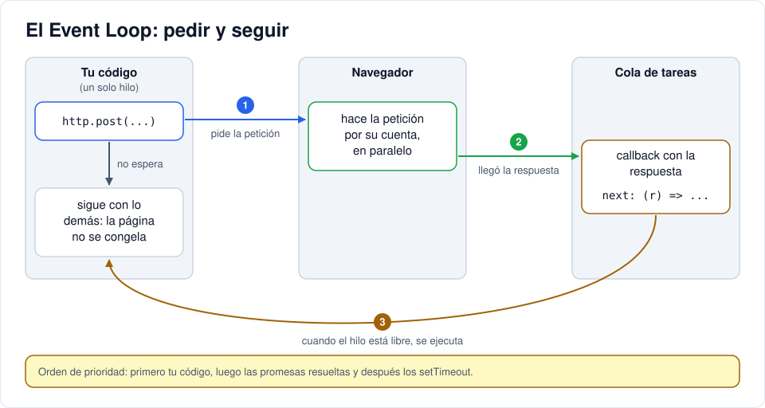
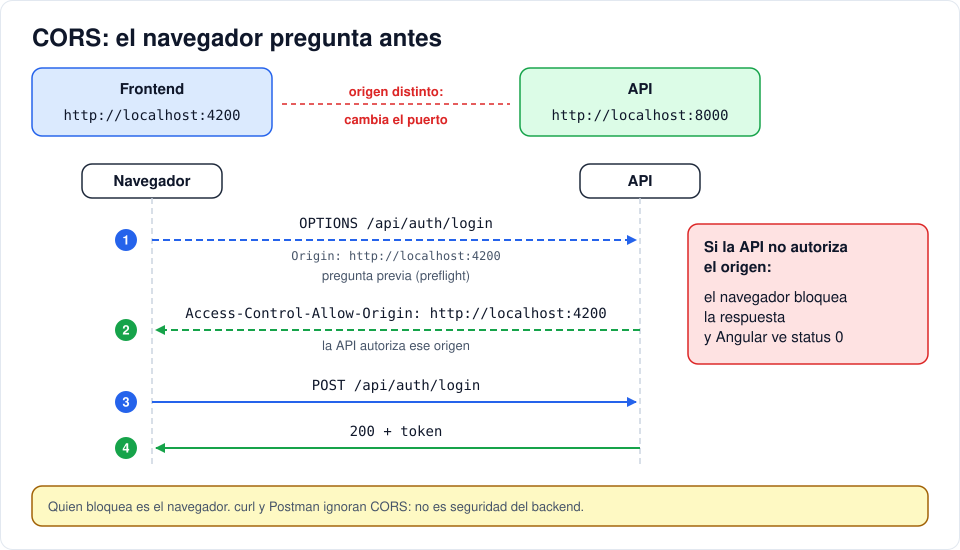

# Iteración 09 · Login contra la API

[← 08 · Navegación con rutas](08-rutas.md) · [Índice](README.md) · [10 · Mantener la sesión →](10-sesion-localstorage.md) <!-- nav -->

**Clase:** martes 10 de noviembre · **Entra en:** parcial 2 · **Duración:** 45 min · **Temas del plan:** asincronismo (Event Loop, Promises, async/await), consumo de APIs REST, contextos de ejecución.

> **JavaScript que vas a ver aquí:** [plantillas de texto](06b-javascript-minimo.md#2-plantillas-de-texto-template-literals), [objetos y JSON](06b-javascript-minimo.md#3-objetos-arreglos-y-json), [funciones como valores](06b-javascript-minimo.md#5-funciones-como-valores), [spread y rest](06b-javascript-minimo.md#7-spread-rest-y-atajos-de-objetos), [operadores cortos](06b-javascript-minimo.md#8-verdadero-falso-y-operadores-cortos). Si algo no lo reconoces, repásalo en la tarea [JavaScript mínimo](06b-javascript-minimo.md) antes de seguir.

## Lo que vas a construir

El formulario de login enviando el correo y la contraseña al backend y recibiendo el token. En el camino te vas a encontrar con un error de **CORS**, vas a entender por qué pasa y lo vas a resolver en el backend.

## Antes de programar

1. Una petición a la API puede tardar 50 milisegundos o 5 segundos. Mientras tanto, ¿qué debería pasar con la pantalla? ¿Se congela?
2. ¿Qué casos de error puede tener el login? Piensa al menos en tres y en qué mensaje le mostrarías al usuario en cada uno.
3. El frontend está en `localhost:4200` y la API en `localhost:8000`. ¿Son el mismo sitio o sitios distintos?

## Conceptos

### JavaScript hace una cosa a la vez

JavaScript corre en un **solo hilo**: ejecuta una instrucción a la vez. Si esperara de brazos cruzados la respuesta del servidor, la página se congelaría: no podrías escribir, hacer scroll ni oprimir nada.

La solución es el **Event Loop** (bucle de eventos):



Tu código **pide** la petición y sigue. El navegador la hace por su cuenta. Cuando llega la respuesta, se pone en una cola, y cuando JavaScript está libre ejecuta la función que dejaste para ese momento (un *callback*).

### Promesas y async/await

Una **promesa** representa un valor que todavía no ha llegado. Con `async/await` se escribe como si fuera secuencial:

```js
async function login(email, password) {
  const res = await fetch('http://localhost:8000/api/auth/login', {
    method: 'POST',
    headers: { 'Content-Type': 'application/json' },
    body: JSON.stringify({ email, password }),
  });
  return await res.json();
}
```

`await` no congela la página: pausa **solo esa función** y deja que el Event Loop atienda otras cosas mientras tanto.

### Observables: lo que usa Angular

El `HttpClient` de Angular no devuelve promesas sino **Observables** (de la librería RxJS). Se parecen, con tres diferencias:

| | Promesa | Observable |
|---|---|---|
| ¿Cuándo empieza? | Apenas se crea | **Solo cuando alguien se suscribe** (`subscribe`) |
| ¿Cuántos valores entrega? | Uno | Cero, uno o muchos |
| ¿Se puede cancelar? | No | Sí |

```ts
this.auth.login(email, password).subscribe({
  next: (respuesta) => { /* salió bien */ },
  error: (e) => { /* falló: e.status tiene el código HTTP */ },
});
```

Si se te olvida el `subscribe`, **la petición nunca sale**. Es el error más común al empezar.

### Servicios e inyección de dependencias

La lógica de hablar con la API no va en el componente sino en un **servicio**: una clase que cualquier componente puede pedir. Con `providedIn: 'root'` existe **una sola instancia** para toda la aplicación.

Para pedirla se usa `inject()`: es la misma idea de `Depends()` en FastAPI. El componente declara lo que necesita y Angular se lo entrega.

### CORS

El navegador aplica la **política del mismo origen**: una página solo puede leer respuestas de su mismo **origen**. El origen es la combinación de protocolo + dominio + puerto:

| Dirección | Origen |
|---|---|
| `http://localhost:4200` | frontend |
| `http://localhost:8000` | API: **otro origen** (cambia el puerto) |

Esto existe para que una página maliciosa que abras no pueda usar tu sesión de, por ejemplo, el banco, haciendo peticiones a escondidas y leyendo las respuestas.

**CORS** (*Cross-Origin Resource Sharing*) es la forma en que un servidor dice: "a este origen sí le permito leer mis respuestas". Lo hace con cabeceras como `Access-Control-Allow-Origin`. Antes de un POST con JSON, el navegador incluso envía una petición previa de verificación con el método `OPTIONS` (*preflight*).

Fíjate en algo importante: quien bloquea es el **navegador**, no el servidor. Un `curl` o Postman ignoran CORS por completo. **CORS no es una medida de seguridad del backend**; protege a los usuarios del navegador.



## Paso a paso

### 1. La dirección de la API

Crea `src/environments/environment.ts`:

```ts
export const environment = {
  apiUrl: 'http://localhost:8000/api',
};
```

Así la dirección queda en un solo lugar. Cuando la API se publique en internet, solo se cambia aquí.

### 2. Habilita HttpClient

En `src/app/app.config.ts`:

```ts
import { provideHttpClient } from '@angular/common/http';
import { ApplicationConfig, provideBrowserGlobalErrorListeners } from '@angular/core';
import { provideRouter } from '@angular/router';
import { routes } from './app.routes';

export const appConfig: ApplicationConfig = {
  providers: [
    provideBrowserGlobalErrorListeners(),
    provideRouter(routes),
    provideHttpClient(),
  ],
};
```

### 3. El servicio de autenticación

```bash
npx ng generate service core/auth --type=service
```

`--type=service` hace que el archivo se llame `auth.service.ts` y la clase `AuthService`. Sin esa opción, se llamarían `auth.ts` y `Auth`, que se confunden fácilmente con otras cosas.

Reemplaza `src/app/core/auth.service.ts`:

```ts
import { HttpClient } from '@angular/common/http';
import { Injectable, inject } from '@angular/core';
import { environment } from '../../environments/environment';
import { LoginResponse } from './models';

@Injectable({
  providedIn: 'root',
})
export class AuthService {
  private http = inject(HttpClient);

  login(email: string, password: string) {
    return this.http.post<LoginResponse>(`${environment.apiUrl}/auth/login`, { email, password });
  }
}
```

- `post<LoginResponse>`: le dice a TypeScript qué forma tendrá la respuesta. **Ojo:** TypeScript confía en ti; no verifica en tiempo de ejecución que el servidor realmente responda eso. Por eso las interfaces deben coincidir con los esquemas del backend.
- `{ email, password }` es un atajo de JavaScript para `{ email: email, password: password }`.
- El método **retorna** el Observable sin suscribirse. Quien lo usa decide cuándo y qué hacer con la respuesta.

### 4. Conecta el formulario

Reemplaza `src/app/pages/login/login.ts`:

```ts
import { Component, inject, signal } from '@angular/core';
import { FormsModule } from '@angular/forms';
import { RouterLink } from '@angular/router';
import { AuthService } from '../../core/auth.service';

@Component({
  imports: [FormsModule, RouterLink],
  selector: 'app-login',
  styleUrl: './login.css',
  templateUrl: './login.html',
})
export class Login {
  private auth = inject(AuthService);

  email = '';
  password = '';
  loading = signal(false);
  error = signal('');

  submit() {
    this.loading.set(true);
    this.error.set('');
    this.auth.login(this.email, this.password).subscribe({
      next: (r) => {
        console.log('Respuesta del login:', r); // TEMPORAL: en la iteración 10 se guarda la sesión
        this.loading.set(false);
      },
      error: (e) => {
        this.error.set(
          e.status === 401
            ? 'Credenciales incorrectas'
            : e.status === 0
              ? 'No se pudo conectar con el servidor'
              : 'Revisa el email y la contraseña',
        );
        this.loading.set(false);
      },
    });
  }
}
```

- `loading` evita que el usuario oprima "Entrar" cinco veces mientras espera.
- `e.status === 0` significa que **no hubo respuesta HTTP**: el servidor está apagado, no hay red o el navegador bloqueó la respuesta por CORS.
- El otro caso (normalmente 422) ocurre cuando el email no tiene formato válido.

En `src/app/pages/login/login.html`, agrega el mensaje de error y desactiva el botón mientras carga. Reemplaza la línea del botón por:

```html
    @if (error()) {
      <p class="error">{{ error() }}</p>
    }
    <button [disabled]="loading()">Entrar</button>
```

### 5. Pruébalo y lee el error

Asegúrate de que el backend esté corriendo (`docker compose ps`). Abre F12 → **Console** y luego intenta entrar con `ana@correo.com` / `ana12345`.

Verás en pantalla *No se pudo conectar con el servidor* y en la consola un error que menciona **CORS policy** y **Access-Control-Allow-Origin**. En la pestaña **Network** verás la petición `OPTIONS` (el *preflight*) fallida.

La API funciona (lo probaste en `/docs`), pero no ha dicho que el origen `http://localhost:4200` esté autorizado.

### 6. Autoriza el frontend en el backend

Agrega al `.env`:

```env
CORS_ORIGINS=http://localhost:4200
```

Agrega el campo en `Settings` (`backend/app/config.py`):

```python
    cors_origins: str = "http://localhost:4200"
```

En `backend/app/main.py`, agrega la importación:

```python
from fastapi.middleware.cors import CORSMiddleware
```

Y justo después de `app = FastAPI(...)`:

```python
app.add_middleware(
    CORSMiddleware,
    allow_origins=[o.strip() for o in settings.cors_origins.split(",")],
    allow_methods=["*"],
    allow_headers=["*"],
)
```

Un **middleware** es código que se ejecuta en **todas** las peticiones, antes y después de tu endpoint. Este agrega las cabeceras de CORS. El `split(",")` permite autorizar varios orígenes separados por coma.

Como cambiaste el `.env`, recrea el contenedor:

```bash
docker compose up -d --force-recreate api
```

## Comprueba

- Login con datos correctos: en la consola aparece el objeto con `access_token` y `user`. En **Network**, la petición `login` responde 200 y en sus **Response Headers** está `access-control-allow-origin: http://localhost:4200`.
- Contraseña incorrecta: *Credenciales incorrectas*.
- Apaga la API (`docker compose stop api`) e intenta entrar: *No se pudo conectar con el servidor*. Vuelve a encenderla con `docker compose start api`.
- Mientras la petición está en curso, el botón se ve desactivado. Para verlo con calma, en Network cambia **No throttling** por **Slow 3G**.

## Para pensar

- En la consola del navegador, **estando en `localhost:4200`**, pega la función `login` de la sección de conceptos y luego ejecuta `await login('ana@correo.com', 'ana12345')`. Ahora abre una pestaña en `http://localhost:8000/docs` y haz lo mismo en su consola. Funciona en las dos, pero en la segunda ni siquiera se necesita CORS. ¿Por qué?
- Copia el contenido de `submit()` en un archivo aparte y reemplázalo temporalmente por una sola línea: `this.auth.login(this.email, this.password);` (sin `subscribe`). Intenta entrar y mira Network. ¿Salió la petición? Devuelve el código a como estaba.
- **Event Loop.** Antes de ejecutarlo, escribe en qué orden crees que salen los números. Luego pégalo en la consola:

  ```js
  console.log(1);
  setTimeout(() => console.log(2), 0);
  Promise.resolve().then(() => console.log(3));
  console.log(4);
  ```

  Pista: las promesas resueltas tienen prioridad sobre los `setTimeout`, aunque el tiempo sea 0.

## Guarda tu avance

Desde la raíz `helpdesk/`:

```bash
git add .
git commit -m "feat: login desde Angular y CORS en la API"
```

---

[← 08 · Navegación con rutas](08-rutas.md) · [Índice](README.md) · [10 · Mantener la sesión →](10-sesion-localstorage.md) <!-- nav -->
