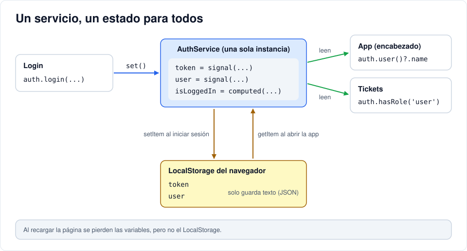

# Iteración 10 · Mantener la sesión

[← 09 · Login contra la API](09-http-login-cors.md) · [Índice](README.md) · [11 · Interceptor y guards →](11-interceptor-guards.md) <!-- nav -->

**Clase:** martes 17 de noviembre · **Entra en:** parcial 2 · **Duración:** 45 min · **Temas del plan:** persistencia de datos del lado del cliente (LocalStorage, IndexedDB), gestión del estado.

> **JavaScript que vas a ver aquí:** [objetos y JSON](06b-javascript-minimo.md#3-objetos-arreglos-y-json), [métodos de arreglos](06b-javascript-minimo.md#6-métodos-de-arreglos), [spread y rest](06b-javascript-minimo.md#7-spread-rest-y-atajos-de-objetos), [operadores cortos](06b-javascript-minimo.md#8-verdadero-falso-y-operadores-cortos). Si algo no lo reconoces, repásalo en la tarea [JavaScript mínimo](06b-javascript-minimo.md) antes de seguir.

## Lo que vas a construir

Después del login, la aplicación recuerda quién eres aunque recargues la página. El encabezado muestra tu nombre y tu rol, el botón *Salir* cierra la sesión y el registro de usuarios queda conectado a la API.

## Antes de programar

1. El login devuelve el token. ¿Dónde lo guardarías para usarlo en las siguientes peticiones? ¿Qué pasa con una variable normal cuando recargas la página?
2. El encabezado (componente `App`) y la pantalla de login (componente `Login`) son componentes distintos. Si el login guarda el usuario, ¿cómo se entera el encabezado?
3. Si el token vence mientras la persona tiene la página abierta, ¿qué debería ver?

## Conceptos

### Estado compartido en un servicio

Un servicio con `providedIn: 'root'` es **una sola instancia** para toda la aplicación. Si guardamos el usuario en una señal **dentro del servicio**, todos los componentes que lo inyecten leen la misma señal. Cuando el login hace `user.set(...)`, el encabezado se redibuja solo, sin que los dos componentes se conozcan.



### `computed`: valores derivados

Un `computed` es una señal que se calcula a partir de otras y se recalcula sola cuando estas cambian:

```ts
readonly isLoggedIn = computed(() => !!this.token() && !!this.user());
```

No lo guardas ni lo actualizas a mano: si cambia `token` o `user`, `isLoggedIn` se entera. `!!` convierte cualquier valor en `true` o `false` (`null` → `false`, un texto → `true`).

### LocalStorage

Es un pequeño almacén clave-valor que trae el navegador:

```js
localStorage.setItem('token', 'eyJ...');     // guardar
localStorage.getItem('token');               // leer ('eyJ...' o null si no existe)
localStorage.removeItem('token');            // borrar
```

- Sobrevive a recargas y a cerrar el navegador.
- Es **por origen**: lo que guarda `localhost:4200` no lo ve otro sitio.
- Solo guarda **texto**. Para guardar un objeto se convierte con `JSON.stringify` y se recupera con `JSON.parse`.

Otras opciones del navegador: `sessionStorage` (igual, pero se borra al cerrar la pestaña) e **IndexedDB** (una base de datos completa en el navegador, para mucha información o para que la aplicación funcione sin internet).

> **Compromiso de seguridad:** cualquier JavaScript que corra en tu página puede leer el LocalStorage. Si un atacante logra inyectar código (un ataque XSS), se lleva el token. La alternativa más segura es una *cookie httpOnly*, que JavaScript no puede leer, pero exige más configuración en el backend. En este curso usamos LocalStorage porque es más fácil de entender y de inspeccionar.

### Operadores que vas a ver

- `a?.b`: *encadenamiento opcional*. Si `a` es `null`, devuelve `undefined` en vez de lanzar un error.
- `a ?? b`: si `a` es `null` o `undefined`, usa `b`.

## Paso a paso

### 1. El servicio completo

Reemplaza `src/app/core/auth.service.ts`:

```ts
import { HttpClient } from '@angular/common/http';
import { Injectable, computed, inject, signal } from '@angular/core';
import { Router } from '@angular/router';
import { tap } from 'rxjs';
import { environment } from '../../environments/environment';
import { LoginResponse, Role, User } from './models';

const TOKEN_KEY = 'token';
const USER_KEY = 'user';

@Injectable({
  providedIn: 'root',
})
export class AuthService {
  private http = inject(HttpClient);
  private router = inject(Router);

  readonly token = signal<string | null>(this.validToken());
  readonly user = signal<User | null>(
    this.token() ? JSON.parse(localStorage.getItem(USER_KEY) ?? 'null') : null,
  );
  readonly isLoggedIn = computed(() => !!this.token() && !!this.user());

  login(email: string, password: string) {
    return this.http
      .post<LoginResponse>(`${environment.apiUrl}/auth/login`, { email, password })
      .pipe(tap((r) => this.setSession(r)));
  }

  register(name: string, email: string, password: string) {
    return this.http.post<User>(`${environment.apiUrl}/auth/register`, { name, email, password });
  }

  logout() {
    localStorage.removeItem(TOKEN_KEY);
    localStorage.removeItem(USER_KEY);
    this.token.set(null);
    this.user.set(null);
    this.router.navigate(['/login']);
  }

  hasRole(...roles: Role[]) {
    const u = this.user();
    return !!u && roles.includes(u.role);
  }

  private setSession(r: LoginResponse) {
    localStorage.setItem(TOKEN_KEY, r.access_token);
    localStorage.setItem(USER_KEY, JSON.stringify(r.user));
    this.token.set(r.access_token);
    this.user.set(r.user);
  }

  /** Devuelve el token guardado solo si el JWT no ha expirado. */
  private validToken(): string | null {
    const t = localStorage.getItem(TOKEN_KEY);
    if (!t) return null;
    try {
      const payload = t.split('.')[1].replace(/-/g, '+').replace(/_/g, '/');
      if (JSON.parse(atob(payload)).exp * 1000 > Date.now()) return t;
    } catch {
      // token malformado: se descarta
    }
    localStorage.removeItem(TOKEN_KEY);
    localStorage.removeItem(USER_KEY);
    return null;
  }
}
```

Recórrelo por partes:

- **Al crear el servicio** (cuando se abre la aplicación), `token` y `user` se inicializan desde el LocalStorage. Por eso la sesión sobrevive a una recarga.
- **`.pipe(tap(...))`**: `pipe` encadena operaciones sobre el Observable; `tap` ejecuta algo con la respuesta **sin modificarla**. Así, quien llame a `login()` y se suscriba, recibe la respuesta, y además el servicio ya guardó la sesión. El componente no tiene que saber cómo se guarda.
- **`hasRole(...roles)`**: los tres puntos permiten llamar `hasRole('admin')` o `hasRole('agent', 'admin')`; dentro, `roles` es una lista.
- **`validToken()`**: toma el payload del JWT (la parte del medio), lo decodifica como hiciste en la iteración 04 y compara `exp` (en segundos) con la hora actual (en milisegundos, por eso `* 1000`). Si venció o está dañado, lo borra.

> Verificar el vencimiento en el frontend es solo para no mostrar una sesión que ya no sirve. El frontend **no puede** verificar la firma (no tiene la clave secreta, ni debe tenerla). Quien decide si el token es válido es siempre el backend.

### 2. El login navega al terminar

En `src/app/pages/login/login.ts`, importa `Router` junto a `RouterLink` e inyéctalo:

```ts
import { Router, RouterLink } from '@angular/router';
```

```ts
  private auth = inject(AuthService);
  private router = inject(Router);
```

Y cambia el `next` del `subscribe`:

```ts
      next: () => this.router.navigate(['/tickets']),
```

El `console.log` temporal desaparece: la sesión ya se guarda en el servicio. Fíjate que en el caso de éxito no hace falta `loading.set(false)`, porque el componente se destruye al navegar.

### 3. El registro conectado

Reemplaza `src/app/pages/register/register.ts`:

```ts
import { Component, inject, signal } from '@angular/core';
import { FormsModule } from '@angular/forms';
import { Router, RouterLink } from '@angular/router';
import { AuthService } from '../../core/auth.service';

@Component({
  imports: [FormsModule, RouterLink],
  selector: 'app-register',
  styleUrl: './register.css',
  templateUrl: './register.html',
})
export class Register {
  private auth = inject(AuthService);
  private router = inject(Router);

  name = '';
  email = '';
  password = '';
  loading = signal(false);
  error = signal('');

  submit() {
    this.loading.set(true);
    this.error.set('');
    this.auth.register(this.name, this.email, this.password).subscribe({
      next: () => this.router.navigate(['/login']),
      error: (e) => {
        this.error.set(
          e.status === 409
            ? 'Ese email ya está registrado'
            : e.status === 0
              ? 'No se pudo conectar con el servidor'
              : 'Datos inválidos: revisa el email y usa una contraseña de 8 a 72 caracteres',
        );
        this.loading.set(false);
      },
    });
  }
}
```

En `register.html`, agrega el bloque de error y `[disabled]="loading()"` al botón, igual que hiciste en el login.

### 4. El encabezado reacciona a la sesión

En `src/app/app.ts`:

```ts
import { Component, inject } from '@angular/core';
import { RouterLink, RouterLinkActive, RouterOutlet } from '@angular/router';
import { AuthService } from './core/auth.service';

@Component({
  imports: [RouterOutlet, RouterLink, RouterLinkActive],
  selector: 'app-root',
  styleUrl: './app.css',
  templateUrl: './app.html',
})
export class App {
  protected readonly appName = 'HelpDesk';
  protected auth = inject(AuthService);
}
```

Reemplaza el `<header>` de `src/app/app.html`:

```html
<header>
  <a class="brand" routerLink="/">{{ appName }}</a>
  @if (auth.isLoggedIn()) {
    <nav>
      <a routerLink="/tickets" routerLinkActive="active">Tickets</a>
      @if (auth.hasRole('admin')) {
        <a routerLink="/users" routerLinkActive="active">Usuarios</a>
      }
    </nav>
    <div class="session">
      <span>
        {{ auth.user()?.name }}
        <small class="badge {{ auth.user()?.role }}">{{ auth.user()?.role }}</small>
      </span>
      <button class="secondary" (click)="auth.logout()">Salir</button>
    </div>
  }
</header>
```

- Sin sesión, solo se ve la marca.
- El enlace *Usuarios* solo aparece para el admin. Esto es comodidad para el usuario, **no** seguridad: la seguridad ya la pusiste en el backend en la iteración 05.

## Comprueba

1. Regístrate con un usuario nuevo desde la aplicación. Debe llevarte al login. Intenta registrarte otra vez con el mismo correo: *Ese email ya está registrado*.
2. Inicia sesión: te lleva a `/tickets` y el encabezado muestra tu nombre, tu rol y *Salir*. Siendo `user`, no ves *Usuarios*.
3. F12 → **Application** (Aplicación) → **Local Storage** → `http://localhost:4200`: ahí están `token` y `user`.
4. Recarga la página: sigues con la sesión iniciada.
5. *Salir*: te lleva al login y las dos claves desaparecen del LocalStorage.
6. Entra como admin: aparece *Usuarios*.

## Para pensar

- En **Application → Local Storage**, con sesión de `user`, edita el valor de `user` y cambia `"role":"user"` por `"role":"admin"`. Recarga. ¿Qué ves en el encabezado? ¿Ganaste permisos de admin **de verdad**? Guarda tu respuesta: en la iteración 13 la vas a comprobar.
- Borra solo la clave `token` y recarga. ¿Qué pasa con la sesión? ¿Qué línea de `isLoggedIn` lo explica?
- ¿Por qué `login()` del servicio usa `tap` en vez de suscribirse él mismo y guardar la sesión?

## Guarda tu avance

```bash
git add .
git commit -m "feat(web): sesión persistente con LocalStorage y registro"
```

---

[← 09 · Login contra la API](09-http-login-cors.md) · [Índice](README.md) · [11 · Interceptor y guards →](11-interceptor-guards.md) <!-- nav -->
