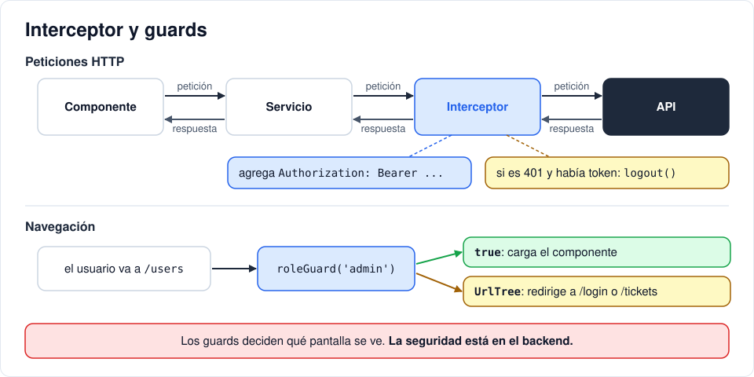

# Iteración 11 · Interceptor y guards

[← 10 · Mantener la sesión](10-sesion-localstorage.md) · [Índice](README.md) · [12 · Tickets conectados →](12-tickets-conectados.md) <!-- nav -->

**Clase:** martes 17 de noviembre · **Entra en:** parcial 2 · **Duración:** 35 min · **Temas del plan:** arquitectura modular, seguridad, programación funcional.

> **JavaScript que vas a ver aquí:** [funciones como valores](06b-javascript-minimo.md#5-funciones-como-valores), [operadores cortos](06b-javascript-minimo.md#8-verdadero-falso-y-operadores-cortos), [plantillas de texto](06b-javascript-minimo.md#2-plantillas-de-texto-template-literals). Si algo no lo reconoces, repásalo en la tarea [JavaScript mínimo](06b-javascript-minimo.md) antes de seguir.

## Lo que vas a construir

- Un **interceptor** que le pone el token a todas las peticiones y cierra la sesión si el backend responde que el token ya no sirve.
- Dos **guards** que impiden entrar a `/tickets` sin sesión y a `/users` sin ser admin.

## Antes de programar

1. Vas a tener seis peticiones distintas a la API que necesitan el token. ¿Le agregarías la cabecera `Authorization` a mano en cada una? ¿Qué pasa el día que se te olvide en una?
2. ¿Qué debería pasar si alguien sin sesión escribe directamente `localhost:4200/tickets` en la barra de direcciones?
3. Busca en el backend algo que cumpla la misma función que un interceptor y algo parecido a un guard.

## Conceptos

### Interceptor: un middleware del lado del cliente

Un interceptor es una función por la que pasan **todas** las peticiones de `HttpClient` antes de salir, y todas las respuestas antes de llegar a quien las pidió:



Es la misma idea del `CORSMiddleware` del backend: código que se escribe una vez y aplica a todo.

Las peticiones en Angular son **inmutables**: no se modifican, se clonan con los cambios (`req.clone(...)`). Es la misma idea de la iteración 07 con las listas.

### Guard: el portero de una ruta

Un **guard** es una función que el router ejecuta **antes** de entrar a una ruta. Retorna:

- `true`: puede pasar.
- Un `UrlTree` (una dirección): no puede pasar y se le redirige allá.

### La misma clausura del backend

En la iteración 05 escribiste `require_roles(Role.admin)`: una función que devuelve otra función. El `roleGuard('admin')` de hoy es exactamente lo mismo en TypeScript. Compáralos:

```python
def require_roles(*roles):          # Python, backend
    def checker(user): ...
    return checker
```

```ts
const roleGuard = (...roles: Role[]): CanActivateFn =>   // TypeScript, frontend
  () => { ... };
```

### Los guards no son seguridad

Un guard solo decide qué **pantalla** se muestra. Cualquier persona puede saltárselo editando el LocalStorage o llamando a la API directamente. La seguridad real está en el backend (iteración 05). Los guards existen para que el usuario honesto no termine en una pantalla que no le va a funcionar.

## Paso a paso

### 1. El interceptor

```bash
npx ng generate interceptor core/auth
```

Reemplaza `src/app/core/auth-interceptor.ts`:

```ts
import { HttpInterceptorFn } from '@angular/common/http';
import { inject } from '@angular/core';
import { catchError, throwError } from 'rxjs';
import { AuthService } from './auth.service';

export const authInterceptor: HttpInterceptorFn = (req, next) => {
  const auth = inject(AuthService);
  const token = auth.token();
  if (token) req = req.clone({ setHeaders: { Authorization: `Bearer ${token}` } });

  return next(req).pipe(
    catchError((err) => {
      // Token vencido o inválido en una petición autenticada: cerrar sesión
      if (err.status === 401 && token) auth.logout();
      return throwError(() => err);
    }),
  );
};
```

- `next(req)` deja pasar la petición (ya con la cabecera) hacia la API.
- `catchError` atrapa los errores de la respuesta. Si es 401 **y** habíamos enviado token, el token ya no sirve (venció o desactivaron la cuenta): se cierra la sesión.
- ¿Por qué `&& token`? Porque el login con contraseña incorrecta también responde 401, y en ese caso no hay sesión que cerrar.
- `throwError(() => err)` vuelve a lanzar el error para que el componente también se entere y muestre su mensaje.

Regístralo en `src/app/app.config.ts`:

```ts
import { provideHttpClient, withInterceptors } from '@angular/common/http';
import { ApplicationConfig, provideBrowserGlobalErrorListeners } from '@angular/core';
import { provideRouter } from '@angular/router';
import { routes } from './app.routes';
import { authInterceptor } from './core/auth-interceptor';

export const appConfig: ApplicationConfig = {
  providers: [
    provideBrowserGlobalErrorListeners(),
    provideRouter(routes),
    provideHttpClient(withInterceptors([authInterceptor])),
  ],
};
```

### 2. El guard de sesión

```bash
npx ng generate guard core/auth --implements CanActivate
```

Reemplaza `src/app/core/auth-guard.ts`:

```ts
import { inject } from '@angular/core';
import { CanActivateFn, Router } from '@angular/router';
import { AuthService } from './auth.service';

/** Exige sesión iniciada; si no, redirige a /login. */
export const authGuard: CanActivateFn = () => {
  const auth = inject(AuthService);
  return auth.isLoggedIn() || inject(Router).createUrlTree(['/login']);
};
```

`a || b` en JavaScript devuelve `a` si es verdadero; si no, devuelve `b`. Se lee: "deja pasar si hay sesión; si no, manda al login".

### 3. El guard de rol

```bash
npx ng generate guard core/role --implements CanActivate
```

Reemplaza `src/app/core/role-guard.ts`:

```ts
import { inject } from '@angular/core';
import { CanActivateFn, Router } from '@angular/router';
import { AuthService } from './auth.service';
import { Role } from './models';

/** Uso: canActivate: [roleGuard('admin')]. La seguridad real está en el backend. */
export const roleGuard =
  (...roles: Role[]): CanActivateFn =>
  () => {
    const auth = inject(AuthService);
    const router = inject(Router);
    if (!auth.isLoggedIn()) return router.createUrlTree(['/login']);
    return auth.hasRole(...roles) || router.createUrlTree(['/tickets']);
  };
```

El archivo `role-guard.spec.ts` que generó Angular ya no coincide con esta forma. Reemplaza su contenido por el de `frontend/src/app/core/role-guard.spec.ts` del repositorio de referencia; lo usarás en la iteración 14.

### 4. Protege las rutas

En `src/app/app.routes.ts`, agrega las importaciones:

```ts
import { authGuard } from './core/auth-guard';
import { roleGuard } from './core/role-guard';
```

Y agrega `canActivate` a las rutas de tickets y usuarios:

```ts
  {
    path: 'tickets',
    canActivate: [authGuard],
    loadComponent: () => import('./pages/tickets/tickets').then((m) => m.Tickets),
  },
  {
    path: 'users',
    canActivate: [roleGuard('admin')],
    loadComponent: () => import('./pages/users/users').then((m) => m.Users),
  },
```

## Comprueba

- Cierra sesión y escribe `localhost:4200/tickets` en la barra: te lleva a `/login`.
- Entra como `user` y escribe `localhost:4200/users`: te lleva a `/tickets`.
- Entra como admin: `/users` sí abre (todavía dice *users works!*).
- Con sesión de `user`, abre Network y escribe `localhost:4200/users` en la barra. Filtra por **JS**: ¿se descargó el chunk de `users`? Ahora cierra sesión, entra como admin, recarga y entra a *Usuarios*: ¿se descargó? El guard se ejecuta **antes** de cargar el componente. (Recarga entre una prueba y otra: un chunk que ya se descargó queda en memoria y no se vuelve a pedir.)
- El interceptor lo vas a ver en acción en la próxima iteración, cuando la pantalla de tickets empiece a hacer peticiones.

## Para pensar

- ¿Qué pasaría si quitaras el `&& token` del interceptor y alguien se equivocara de contraseña en el login?
- Escribe en una frase la diferencia entre lo que protege `roleGuard('admin')` y lo que protege `require_roles(Role.admin)`.

## Guarda tu avance

```bash
git add .
git commit -m "feat(web): interceptor de autenticación y guards de rutas"
```

---

[← 10 · Mantener la sesión](10-sesion-localstorage.md) · [Índice](README.md) · [12 · Tickets conectados →](12-tickets-conectados.md) <!-- nav -->
