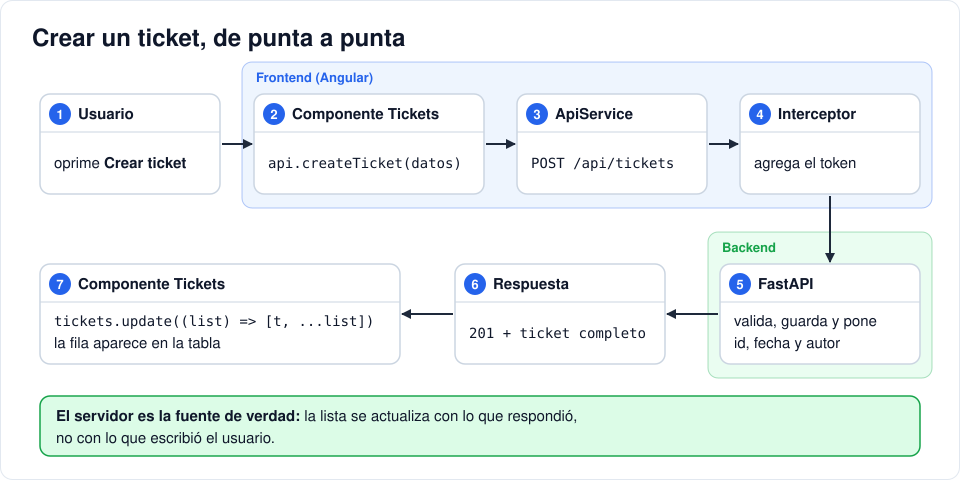

# Iteración 12 · Tickets conectados

[← 11 · Interceptor y guards](11-interceptor-guards.md) · [Índice](README.md) · [13 · Panel de administración →](13-panel-admin.md) <!-- nav -->

**Clase:** martes 17 de noviembre · **Entra en:** parcial 2 · **Duración:** 45 min · **Temas del plan:** consumo de APIs REST, arquitectura del frontend.

> **JavaScript que vas a ver aquí:** [métodos de arreglos](06b-javascript-minimo.md#6-métodos-de-arreglos), [spread y rest](06b-javascript-minimo.md#7-spread-rest-y-atajos-de-objetos), [plantillas de texto](06b-javascript-minimo.md#2-plantillas-de-texto-template-literals). Si algo no lo reconoces, repásalo en la tarea [JavaScript mínimo](06b-javascript-minimo.md) antes de seguir.

## Lo que vas a construir

La pantalla de tickets trabajando con datos reales: lista, crea, cambia el estado y borra contra la API. Lo que ve y puede hacer cada persona depende de su rol.

## Antes de programar

1. Haz una lista de las peticiones que necesita la pantalla de tickets: método, ruta y qué envía. Usa la tabla de la iteración 03.
2. Cuando creas un ticket, el servidor responde con el ticket completo. ¿Agregarías a la tabla lo que el usuario escribió en el formulario o lo que respondió el servidor? ¿Qué campos tiene uno que no tenga el otro?
3. Para cada rol, ¿qué partes de la pantalla deberían verse? (formulario, selector de estado, botón borrar).

## Conceptos

### Cada pieza con una sola responsabilidad

| Pieza | Responsabilidad |
|---|---|
| `ApiService` | Saber **cómo** hablar con la API: rutas, métodos, cuerpos. |
| `AuthService` | Saber **quién** está usando la aplicación. |
| Interceptor | Ponerle el token a todo y reaccionar al 401. |
| Componente `Tickets` | Mostrar la pantalla y reaccionar a lo que hace el usuario. |

El componente no sabe que existe `http://localhost:8000` ni que hay un token: solo dice `api.tickets()`. Si mañana la ruta cambia, solo se toca el servicio. Esta separación es la idea detrás de patrones como *container/presentational* y de las arquitecturas limpias: cada pieza cambia por una sola razón.

### El servidor manda

Después de crear o modificar algo, la lista se actualiza con **lo que respondió el servidor**, no con lo que escribió el usuario. El servidor es quien pone el `id`, la fecha, el autor y el estado inicial; además pudo haber rechazado o ajustado algo. A eso se le llama que el servidor es la **fuente de verdad**.

Si una operación falla, se vuelve a cargar la lista completa para que la pantalla quede igual a lo que hay realmente en la base de datos.

### Cargar datos al crear el componente

El código que se escribe en el `constructor` se ejecuta cuando Angular crea el componente, es decir, cuando el usuario entra a la ruta. Ahí pedimos la lista. (También existe el método `ngOnInit` para lo mismo; en componentes sencillos el constructor es suficiente.)

### Separar `[(ngModel)]` en dos

`[(ngModel)]="x"` es un atajo para `[ngModel]="x" (ngModelChange)="x = $event"`. En el selector de estado no queremos solo cambiar una variable: queremos **llamar a la API**. Por eso se separa:

```html
<select [ngModel]="t.status" (ngModelChange)="setStatus(t, $event)">
```

`$event` es el valor nuevo que eligió el usuario.



## Paso a paso

### 1. El servicio de datos

```bash
npx ng generate service core/api --type=service
```

Reemplaza `src/app/core/api.service.ts`:

```ts
import { HttpClient } from '@angular/common/http';
import { Injectable, inject } from '@angular/core';
import { environment } from '../../environments/environment';
import { Priority, Role, Ticket, TicketStatus, User } from './models';

@Injectable({
  providedIn: 'root',
})
export class ApiService {
  private http = inject(HttpClient);
  private url = environment.apiUrl;

  tickets() {
    return this.http.get<Ticket[]>(`${this.url}/tickets`);
  }
  createTicket(data: { title: string; description: string; priority: Priority }) {
    return this.http.post<Ticket>(`${this.url}/tickets`, data);
  }
  updateTicketStatus(id: number, status: TicketStatus) {
    return this.http.patch<Ticket>(`${this.url}/tickets/${id}`, { status });
  }
  deleteTicket(id: number) {
    return this.http.delete<void>(`${this.url}/tickets/${id}`);
  }

  users() {
    return this.http.get<User[]>(`${this.url}/users`);
  }
  updateUser(id: number, data: { role?: Role; is_active?: boolean }) {
    return this.http.patch<User>(`${this.url}/users/${id}`, data);
  }
}
```

Compara cada método con su endpoint del backend: mismo método HTTP, misma ruta, mismo cuerpo que el esquema de entrada. `role?:` significa que el campo es **opcional**, igual que `role: Role | None = None` en `UserUpdate`.

### 2. El componente

Reemplaza `src/app/pages/tickets/tickets.ts`:

```ts
import { DatePipe } from '@angular/common';
import { Component, inject, signal } from '@angular/core';
import { FormsModule } from '@angular/forms';
import { ApiService } from '../../core/api.service';
import { AuthService } from '../../core/auth.service';
import { Priority, Ticket, TicketStatus } from '../../core/models';

@Component({
  imports: [FormsModule, DatePipe],
  selector: 'app-tickets',
  styleUrl: './tickets.css',
  templateUrl: './tickets.html',
})
export class Tickets {
  private api = inject(ApiService);
  protected auth = inject(AuthService);

  tickets = signal<Ticket[]>([]);
  error = signal('');

  title = '';
  description = '';
  priority: Priority = 'medium';

  constructor() {
    this.load();
  }

  load() {
    this.api.tickets().subscribe({
      next: (t) => this.tickets.set(t),
      error: () => this.error.set('No se pudieron cargar los tickets'),
    });
  }

  create() {
    this.api
      .createTicket({ title: this.title, description: this.description, priority: this.priority })
      .subscribe({
        next: (t) => {
          this.tickets.update((list) => [t, ...list]);
          this.title = this.description = '';
          this.priority = 'medium';
        },
        error: () => this.error.set('No se pudo crear el ticket'),
      });
  }

  setStatus(t: Ticket, status: TicketStatus) {
    this.api.updateTicketStatus(t.id, status).subscribe({
      next: (u) => this.tickets.update((list) => list.map((x) => (x.id === u.id ? u : x))),
      error: () => {
        this.error.set('No se pudo actualizar el estado');
        this.load();
      },
    });
  }

  remove(t: Ticket) {
    if (!confirm(`¿Borrar el ticket #${t.id}?`)) return;
    this.api.deleteTicket(t.id).subscribe({
      next: () => this.tickets.update((list) => list.filter((x) => x.id !== t.id)),
      error: () => this.error.set('No se pudo borrar el ticket'),
    });
  }
}
```

Compara con la versión de la iteración 07:

- `MOCK_TICKETS` desapareció: la lista empieza vacía y se llena con `load()`.
- En `create()`, `t` es el ticket **que respondió el servidor**. Ya no inventamos `id` ni fecha.
- `setStatus` usa el `map` del reto de la iteración 07: reemplaza solo el ticket que cambió.
- `remove` borra de la lista **solo si el servidor confirmó**. `confirm()` muestra un cuadro de diálogo nativo del navegador para evitar borrados accidentales.
- `auth` es `protected` porque la plantilla lo necesita para preguntar por el rol.

### 3. La plantilla según el rol

Reemplaza `src/app/pages/tickets/tickets.html`:

```html
<h1>{{ auth.hasRole('user') ? 'Mis tickets' : 'Todos los tickets' }}</h1>

@if (auth.hasRole('user')) {
  <div class="card">
    <h2>Nuevo ticket</h2>
    <form (ngSubmit)="create()">
      <label>Título <input name="title" [(ngModel)]="title" required maxlength="120" /></label>
      <label>
        Descripción
        <textarea name="description" rows="3" [(ngModel)]="description" required></textarea>
      </label>
      <label>
        Prioridad
        <select name="priority" [(ngModel)]="priority">
          <option value="low">Baja</option>
          <option value="medium">Media</option>
          <option value="high">Alta</option>
        </select>
      </label>
      <button>Crear ticket</button>
    </form>
  </div>
}

@if (error()) {
  <p class="error">{{ error() }}</p>
}

<div class="card">
  <table>
    <thead>
      <tr>
        <th>#</th>
        <th>Título</th>
        <th>Autor</th>
        <th>Prioridad</th>
        <th>Estado</th>
        <th>Fecha</th>
        <th></th>
      </tr>
    </thead>
    <tbody>
      @for (t of tickets(); track t.id) {
        <tr>
          <td>{{ t.id }}</td>
          <td>
            <strong>{{ t.title }}</strong><br />
            <small class="ticket-desc">{{ t.description }}</small>
          </td>
          <td>{{ t.author.name }}</td>
          <td>
            <span class="badge {{ t.priority }}">{{ t.priority }}</span>
          </td>
          <td>
            @if (auth.hasRole('agent', 'admin')) {
              <select [ngModel]="t.status" (ngModelChange)="setStatus(t, $event)">
                <option value="open">open</option>
                <option value="in_progress">in_progress</option>
                <option value="closed">closed</option>
              </select>
            } @else {
              <span class="badge {{ t.status }}">{{ t.status }}</span>
            }
          </td>
          <td>{{ t.created_at | date: 'short' }}</td>
          <td>
            @if (auth.hasRole('admin')) {
              <button class="danger" (click)="remove(t)">Borrar</button>
            }
          </td>
        </tr>
      } @empty {
        <tr>
          <td colspan="7">No hay tickets.</td>
        </tr>
      }
    </tbody>
  </table>
</div>
```

Agrega a `src/app/pages/tickets/tickets.css`:

```css
td select {
  padding: 4px 8px;
}
```

## Comprueba

Usa tres sesiones: lo más cómodo es una ventana normal, una de incógnito y otro navegador, porque cada una tiene su propio LocalStorage.

1. **Como `user`:** el título dice *Mis tickets* y aparece el formulario. Crea un ticket. Recarga la página: el ticket sigue ahí (esta es la respuesta a la pregunta de la iteración 07).
2. En **Network**, haz clic en la petición `tickets` y busca en **Request Headers** la cabecera `Authorization: Bearer ...`. Nadie la escribió en el componente: la puso el interceptor.
3. **Como `agent`:** *Todos los tickets*, sin formulario, con selector de estado. Cambia un estado y mira en Network el `PATCH` y su respuesta.
4. **Como `admin`:** aparece el botón *Borrar*. Borra un ticket y mira la respuesta **204** en Network.
5. Vuelve a la sesión del `user` y recarga: ¿ves el estado que cambió el agente?
6. **Prueba el 401:** con cualquier sesión, ve a **Application → Local Storage**, cambia una letra de la **última** parte del `token` (la firma) y recarga. El frontend no puede detectar el cambio porque no verifica firmas, así que intenta cargar los tickets; el backend responde 401 y el interceptor te saca al login.

## Para pensar

- En el paso 6, ¿quién detectó que el token era falso? ¿Por qué `validToken()` del frontend no lo detectó?
- Si el cambio de estado falla, ¿por qué se llama a `load()` en vez de dejar la lista como está? Piensa qué está mostrando el `<select>` en ese momento.
- **Reto:** agrega arriba de la tabla un campo de búsqueda que filtre los tickets por título mientras escribes, sin hacer peticiones nuevas. Pistas: una señal `search = signal('')` y un `computed` que devuelva `this.tickets().filter(...)`. En el `@for`, recorre el `computed` en vez de `tickets()`.

## Guarda tu avance

```bash
git add .
git commit -m "feat(web): tickets conectados a la API según el rol"
```

---

[← 11 · Interceptor y guards](11-interceptor-guards.md) · [Índice](README.md) · [13 · Panel de administración →](13-panel-admin.md) <!-- nav -->
