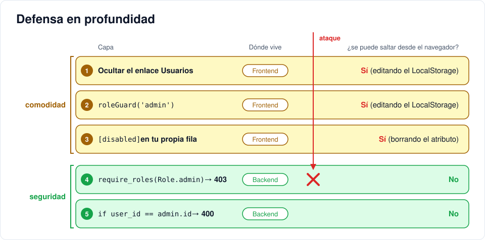

# Iteración 13 · Panel de administración

[← 12 · Tickets conectados](12-tickets-conectados.md) · [Índice](README.md) · [14 · Cierre: pruebas, despliegue y auditoría con IA →](14-cierre.md) <!-- nav -->

**Clase:** martes 24 de noviembre · **Entra en:** parcial 2 · **Duración:** 35 min · **Temas del plan:** auditoría de seguridad, interfaces interactivas.

## Lo que vas a construir

La pantalla `/users`, donde el admin cambia el rol de cualquier usuario y activa o desactiva cuentas. Después vas a intentar romper la seguridad desde el navegador para comprobar que el backend aguanta.

## Antes de programar

1. ¿Qué debería pasar en la pantalla si el admin intenta cambiar su **propio** rol? ¿Basta con que el frontend lo impida?
2. Si a Ana le cambian el rol de `user` a `agent` mientras ella tiene la aplicación abierta, ¿cuándo ve Ana los nuevos permisos? Mira cómo funcionan `token`, `user` y el LocalStorage.

## Conceptos

### Defensa en profundidad

Ninguna capa de seguridad es perfecta, así que se ponen varias:

| Capa | Qué hace | ¿Se puede saltar desde el navegador? |
|---|---|---|
| Ocultar el enlace *Usuarios* | El usuario honesto no lo ve | Sí, editando el LocalStorage |
| `roleGuard('admin')` | Bloquea la navegación a `/users` | Sí, editando el LocalStorage |
| `[disabled]` en los controles | Impide modificar tu propia cuenta | Sí, borrando el atributo con el inspector |
| `require_roles(Role.admin)` en la API | Rechaza con 403 | **No** |
| `if user_id == admin.id` en la API | Rechaza con 400 | **No** |

Las tres primeras capas mejoran la experiencia. Las dos últimas son la seguridad.



### Más enlaces de propiedades y eventos

- `[disabled]="isMe(u)"`: desactiva el control cuando la condición es verdadera.
- `[checked]="u.is_active"`: marca la casilla según el dato.
- `(change)="..."`: se dispara cuando el usuario cambia la casilla.

## Paso a paso

### 1. El componente

Reemplaza `src/app/pages/users/users.ts`:

```ts
import { Component, inject, signal } from '@angular/core';
import { FormsModule } from '@angular/forms';
import { ApiService } from '../../core/api.service';
import { AuthService } from '../../core/auth.service';
import { Role, User } from '../../core/models';

@Component({
  imports: [FormsModule],
  selector: 'app-users',
  styleUrl: './users.css',
  templateUrl: './users.html',
})
export class Users {
  private api = inject(ApiService);
  private auth = inject(AuthService);

  users = signal<User[]>([]);
  error = signal('');

  constructor() {
    this.load();
  }

  isMe(u: User) {
    return u.id === this.auth.user()?.id;
  }

  load() {
    this.api.users().subscribe({
      next: (u) => this.users.set(u),
      error: () => this.error.set('No se pudieron cargar los usuarios'),
    });
  }

  update(u: User, data: { role?: Role; is_active?: boolean }) {
    this.api.updateUser(u.id, data).subscribe({
      next: (n) => this.users.update((list) => list.map((x) => (x.id === n.id ? n : x))),
      error: () => {
        this.error.set('No se pudo actualizar el usuario');
        this.load();
      },
    });
  }
}
```

Fíjate que tiene la misma estructura que `Tickets`: señal con la lista, `load()` en el constructor y actualización con `map` usando lo que responde el servidor. Cuando un patrón se repite, ya lo entendiste.

### 2. La plantilla

Reemplaza `src/app/pages/users/users.html`:

```html
<h1>Usuarios</h1>
@if (error()) {
  <p class="error">{{ error() }}</p>
}
<div class="card">
  <table>
    <thead>
      <tr>
        <th>Nombre</th>
        <th>Email</th>
        <th>Rol</th>
        <th>Activo</th>
      </tr>
    </thead>
    <tbody>
      @for (u of users(); track u.id) {
        <tr>
          <td>{{ u.name }}</td>
          <td>{{ u.email }}</td>
          <td>
            <select
              [ngModel]="u.role"
              (ngModelChange)="update(u, { role: $event })"
              [disabled]="isMe(u)"
            >
              <option value="user">user</option>
              <option value="agent">agent</option>
              <option value="admin">admin</option>
            </select>
          </td>
          <td>
            <input
              type="checkbox"
              [checked]="u.is_active"
              [disabled]="isMe(u)"
              (change)="update(u, { is_active: !u.is_active })"
            />
          </td>
        </tr>
      }
    </tbody>
  </table>
</div>
```

Reemplaza `src/app/pages/users/users.css`:

```css
td select {
  padding: 4px 8px;
}

input[type='checkbox'] {
  width: 18px;
  height: 18px;
  padding: 0;
}
```

## Comprueba

1. Como admin, abre *Usuarios*. Tu propia fila tiene el selector y la casilla desactivados.
2. Cambia a Beto a `agent`. Abre una sesión de Beto en incógnito: ¿ya ve *Todos los tickets*? Si no, cierra sesión y vuelve a entrar. ¿Por qué hizo falta? (Pista: ¿de dónde sale el rol que usa el frontend?)
3. Desactiva a Beto. En la ventana de Beto, recarga o crea un ticket: el backend responde 401 y el interceptor lo saca. Reactívalo.

### Ahora intenta romperlo

Haz estos tres ataques. Antes de cada uno, escribe qué crees que va a pasar.

**Ataque 1: hacerse admin desde el LocalStorage.** Entra como `user`. En **Application → Local Storage**, cambia `"role":"user"` por `"role":"admin"` dentro de `user` y recarga.

- ¿Aparece el enlace *Usuarios*? Entra. ¿Qué muestra la pantalla y qué responde `GET /api/users` en Network?
- En *Tickets*, el título dice *Todos los tickets*. ¿Ves los de todos o solo los tuyos? ¿Quién decidió eso?
- ¿Aparece el botón *Borrar*? Oprímelo. ¿Qué responde la API?

**Ataque 2: modificarse a sí mismo.** Entra como admin, abre *Usuarios*, haz clic derecho en tu selector de rol → **Inspeccionar**, y en el HTML borra el atributo `disabled`. Cámbiate el rol a `user`. ¿Qué responde la API?

**Ataque 3: saltarse el frontend.** Copia tu token de `user` desde el LocalStorage, ve a `http://localhost:8000/docs`, ponlo en **Authorize** y ejecuta `DELETE /api/tickets/{id}`. ¿Qué responde?

Compara las respuestas con la tabla de defensa en profundidad.

## Para pensar

- En el ataque 1, la interfaz mostraba botones de admin. ¿Eso es una vulnerabilidad? ¿Qué sí sería una vulnerabilidad?
- Un compañero propone guardar el rol solo en el frontend "porque igual el guard protege la ruta". Con lo que viste hoy, ¿qué le respondes?
- **Reto:** cuando el admin cambia el rol de alguien, el afectado no lo ve hasta que vuelve a iniciar sesión. Propón (sin programarlo) una forma de que el frontend tenga el rol actualizado. Pista: ¿qué endpoint nuevo necesitarías en el backend?

## Guarda tu avance

```bash
git add .
git commit -m "feat(web): panel de administración de usuarios"
```

---

[← 12 · Tickets conectados](12-tickets-conectados.md) · [Índice](README.md) · [14 · Cierre: pruebas, despliegue y auditoría con IA →](14-cierre.md) <!-- nav -->
