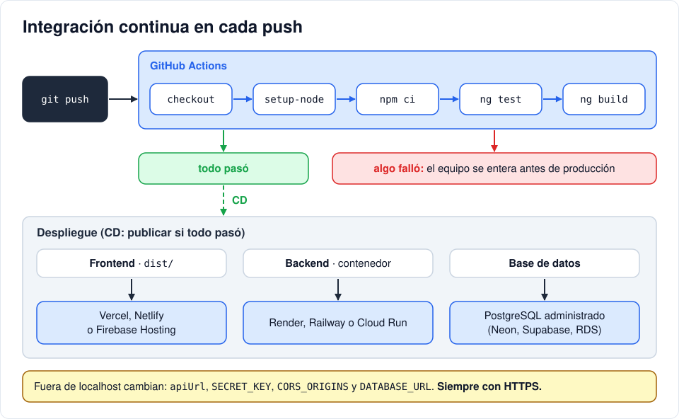

# Iteración 14 · Cierre: pruebas, despliegue y auditoría con IA

[← 13 · Panel de administración](13-panel-admin.md) · [Índice](README.md) · [Extra · Correos automáticos (opcional) →](extra-correos.md) <!-- nav -->

**Clase:** martes 24 de noviembre · **Entra en:** parcial 2 · **Duración:** 60 min (si no alcanza el tiempo, las partes 3 y 4 se terminan en casa antes del parcial) · **Temas del plan:** auditoría técnica asistida por IA, CI/CD, despliegue, Git colaborativo.

## Lo que vas a construir

- Las pruebas automáticas del frontend corriendo y pasando.
- La versión de producción del frontend.
- Un flujo de integración continua en GitHub que ejecuta las pruebas en cada `push`.
- Un ejercicio de auditoría de código generado por IA.

## Antes de programar

1. Cada vez que cambiaste algo en este proyecto, ¿cómo comprobaste que no dañaste lo anterior? ¿Cuánto tiempo te tomaría revisar a mano todo lo que construiste?
2. ¿Qué cosas de tu proyecto dependen de que todo corra en `localhost`? Haz la lista.

## Parte 1 · Pruebas automáticas

### Concepto

Una **prueba unitaria** es código que ejecuta una pieza pequeña de tu aplicación y verifica que haga lo esperado. Su valor real aparece **después**: cuando cambias algo, en segundos te dicen si dañaste otra cosa.

Una prueba tiene tres pasos: **preparar**, **ejecutar** y **verificar**. Mira esta, de `auth-guard.spec.ts`:

```ts
it('redirects to /login when there is no session', () => {
  const result = run() as UrlTree;                                          // ejecutar (sin sesión)
  expect(TestBed.inject(Router).serializeUrl(result)).toBe('/login');       // verificar
});
```

La preparación está en el `beforeEach`, que borra el LocalStorage antes de cada prueba para que ninguna dependa de otra.

### Paso a paso

Los archivos `.spec.ts` que generó Angular con cada componente solo verifican que el componente se crea, y varios ya fallan porque los componentes ahora necesitan `HttpClient` y el router. Reemplázalos por los del repositorio de referencia, que prueban el comportamiento real (roles, errores, peticiones).

Desde `helpdesk/frontend`, suponiendo que clonaste la referencia en `../../helpdesk-referencia`:

```powershell
# Windows
robocopy ..\..\helpdesk-referencia\frontend\src\app src\app *.spec.ts /S
```

```bash
# Mac o Linux
rsync -a --include='*/' --include='*.spec.ts' --exclude='*' ../../helpdesk-referencia/frontend/src/app/ src/app/
```

Ejecuta las pruebas:

```bash
npx ng test --watch=false
```

Deben pasar todas. Si alguna falla, lee su nombre: describe qué comportamiento esperaba. Normalmente indica una diferencia entre tu código y el de la guía.

### Comprueba que las pruebas sirven

En `auth-interceptor.ts`, quita el `&& token` de la condición del 401 y vuelve a ejecutar las pruebas. ¿Cuál falla? Lee su nombre y relaciónalo con lo que discutiste en la iteración 11. Devuelve el código a como estaba.

Eso es una **regresión**: un cambio que daña algo que ya funcionaba. Las pruebas la detectaron sin que tuvieras que abrir el navegador.

## Parte 2 · Versión de producción

```bash
npx ng build
```

El resultado queda en `frontend/dist/frontend/browser/`: un `index.html`, archivos `.js` y `.css`. Ábrelos: el código está **minificado** (sin espacios, con nombres cortos) para que pese menos, y los nombres de archivo llevan un *hash* (`main-SP2YD62J.js`) para que el navegador descargue la versión nueva cada vez que cambie.

Esa carpeta son archivos estáticos: cualquier servidor web o servicio de hosting puede publicarlos.

### Qué cambiar para publicarlo en internet

No hay tiempo para hacer el despliegue completo en clase, pero esta es la lista de lo que cambia cuando se sale de `localhost`. Compárala con tu respuesta a la pregunta 2.

| Pieza | Dónde se puede publicar | Qué hay que cambiar |
|---|---|---|
| Frontend | Vercel, Netlify, Firebase Hosting | `apiUrl` con la dirección pública de la API. Configurar que todas las rutas respondan con `index.html` (si no, recargar en `/tickets` da 404, porque esa ruta solo existe dentro de Angular). |
| Backend | Render, Railway, Google Cloud Run, AWS | Una `SECRET_KEY` nueva y secreta, `CORS_ORIGINS` con el dominio del frontend, quitar `--reload`. |
| Base de datos | PostgreSQL administrado (Neon, Supabase, AWS RDS) | `DATABASE_URL` del proveedor. |
| Todo | | HTTPS obligatorio. El `.env` **nunca** en el repositorio: los valores se configuran en el panel del proveedor. |

Para tener una `apiUrl` distinta en desarrollo y producción, Angular puede generar un archivo de entorno por configuración:

```bash
npx ng generate environments
```

Crea `environment.development.ts` y configura `angular.json` para que `ng serve` use ese y `ng build` use `environment.ts`.

## Parte 3 · Integración continua (CI)

**CI** (*Continuous Integration*) significa que cada vez que alguien sube código, un servidor lo descarga, instala todo y ejecuta las pruebas y la compilación. Si algo falla, el equipo se entera antes de que llegue a producción. **CD** (*Continuous Deployment*) agrega el paso de publicar automáticamente si todo pasó.



Crea `.github/workflows/ci.yml` en la raíz del repositorio:

```yaml
name: CI

on: [push, pull_request]

jobs:
  frontend:
    runs-on: ubuntu-latest
    defaults:
      run:
        working-directory: frontend
    steps:
      - uses: actions/checkout@v5
      - uses: actions/setup-node@v5
        with:
          node-version: lts/*
          cache: npm
          cache-dependency-path: frontend/package-lock.json
      - run: npm ci
      - run: npx ng test --watch=false
      - run: npx ng build
```

Léelo como una receta: en una máquina Ubuntu nueva, descarga el repositorio, instala Node, instala dependencias exactas (`npm ci` usa el `package-lock.json` sin modificarlo), ejecuta las pruebas y compila.

Sube tu repositorio a GitHub (crea el repositorio vacío en la página y sigue las instrucciones de `git remote add` y `git push`). En la pestaña **Actions** verás el flujo ejecutándose. Si queda en verde, todo pasó.

### Trabajo en equipo con Git

En un equipo de desarrollo (y si quieres practicarlo con las ideas del final de esta iteración) se trabaja así:

1. Nadie trabaja directo en `main`. Cada funcionalidad va en su rama: `git switch -c feat/buscar-tickets`.
2. Commits pequeños con mensajes que digan **qué** y **por qué**: `feat(web): filtro de tickets por título`.
3. Se sube la rama y se abre un **Pull Request** en GitHub.
4. Otro integrante revisa el código **antes** de unirlo. La CI debe estar en verde.

La revisión de código (*code review*) no es para buscar culpables: es la última oportunidad de encontrar un error barato de arreglar.

## Parte 4 · Auditoría de código generado por IA

Un asistente de IA genera código que **se ve** correcto. Tu trabajo como ingeniero es saber cuándo no lo es. Los errores típicos son:

- Usar **versiones viejas** de una librería (sintaxis de Angular de hace cinco años, librerías de Python abandonadas).
- **Inventar** funciones u opciones que no existen.
- Resolver el caso feliz y **olvidar la seguridad**: validación, permisos, datos sensibles.
- Funcionar en su ejemplo, pero no encajar con la **arquitectura** de tu proyecto.

### Ejercicio

Un compañero le pidió a una IA "un endpoint de registro en FastAPI" y "un componente de Angular que liste tickets", y pegó esto. Encuentra **al menos cuatro problemas en cada uno**, explica por qué cada uno es un problema y di cómo lo resolvimos en este proyecto. Hazlo primero sin IA.

```python
from jose import jwt
from passlib.context import CryptContext

@router.post("/register")
def register(data: dict, db: DB):
    user = User(**data)
    user.password_hash = data["password"]
    db.add(user)
    db.commit()
    return user
```

```ts
import { Component, OnInit } from '@angular/core';
import { HttpClient } from '@angular/common/http';

@Component({
  selector: 'app-tickets',
  template: `<ul><li *ngFor="let t of tickets">{{ t.title }}</li></ul>`,
})
export class TicketsComponent implements OnInit {
  tickets: any[] = [];

  constructor(private http: HttpClient) {}

  ngOnInit() {
    this.http
      .get('http://localhost:8000/api/tickets', {
        headers: { Authorization: 'Bearer ' + localStorage.getItem('token') },
      })
      .subscribe((r: any) => (this.tickets = r));
  }
}
```

Después de hacer tu lista, pégale el código a un asistente de IA y pídele que lo revise. Compara: ¿encontró lo mismo que tú? ¿Encontró algo que tú no? ¿Dijo algo **incorrecto**? Ese último punto es el más importante del ejercicio.

<details>
<summary>Respuestas (para revisar después de hacer tu lista)</summary>

**Backend**

1. `data: dict` no valida nada: cualquier campo, cualquier tipo. Nosotros usamos el esquema `RegisterIn`.
2. `User(**data)` deja que el cliente envíe `role: "admin"` y se registre como administrador. Nosotros construimos el `User` campo por campo y forzamos `role=Role.user`.
3. Guarda la contraseña en **texto plano** en `password_hash`. Nosotros usamos `hash_password` con bcrypt.
4. Retorna el objeto completo sin `response_model`: expone la contraseña. Nosotros usamos `response_model=UserOut`.
5. No revisa si el email ya existe (respondería un error 500 por la restricción `unique` en vez de un 409) y no lo pasa a minúsculas.
6. Importa `jose` y `passlib`, que no están en `requirements.txt` (el proyecto usa `PyJWT` y `bcrypt`), y ni siquiera los usa.
7. Responde 200 en vez de 201.

**Frontend**

1. `*ngFor` es sintaxis antigua y, en un componente standalone, no funciona sin importar `NgFor`. Hoy se usa `@for` con `track`.
2. `tickets` es una propiedad normal, no una señal. En una aplicación sin zone.js (como la nuestra), asignarla dentro del `subscribe` **no actualiza la pantalla** de forma confiable.
3. `any` elimina la ayuda de TypeScript. Nosotros usamos la interfaz `Ticket`.
4. La URL está escrita a mano: debería salir de `environment.apiUrl` y la petición vivir en `ApiService`, no en el componente.
5. Pone la cabecera `Authorization` a mano: duplica el interceptor y, si no hay token, envía `Bearer null`.
6. No maneja errores: si la API falla, el usuario no ve ningún mensaje.
7. El nombre `TicketsComponent` y el decorador sin `imports` corresponden a un estilo anterior al que genera la versión actual del CLI.

</details>

## Para ir más allá

Son opcionales y cada una toca temas del plan de estudio. También son buen entrenamiento para el parcial 2, porque se parecen a los cambios en vivo que te pueden pedir. Antes de programar, escribe la especificación: qué cambia en la base de datos, qué endpoints nuevos se necesitan, quién puede usarlos y qué pantallas cambian.

- **Comentarios en los tickets:** una tabla nueva, relación con tickets y usuarios, permisos por rol.
- **Búsqueda y filtros:** por estado y prioridad, con `computed` en el frontend o con parámetros de consulta (`?status=open`) en el backend. ¿Cuándo conviene cada uno?
- **Clasificación automática con un modelo de lenguaje:** al crear un ticket, el backend le pide a la API de un LLM que sugiera la prioridad. La llamada se hace **desde el backend**, nunca desde Angular: la clave de la API del LLM no puede llegar al navegador. ¿Qué haces si el servicio del LLM no responde?
- **Modo sin conexión:** guardar la última lista de tickets en IndexedDB para verla sin internet.
- **Tailwind CSS:** reemplazar los estilos por clases utilitarias de Tailwind y comparar el resultado.

## Guarda tu avance

```bash
git add .
git commit -m "test: pruebas del frontend y flujo de CI"
git push
```

## Antes del parcial 2 (martes 1 de diciembre)

El parcial 2 es sobre el proyecto completo. Verifica que:

- `git log --oneline` muestra un commit por cada iteración, de la 00 a la 14.
- Backend y frontend arrancan en tu computador y puedes recorrer el flujo completo con los tres roles.
- `npx ng test --watch=false` pasa.
- Puedes explicar, archivo por archivo, qué pasa desde que un usuario oprime *Crear ticket* hasta que la fila aparece en la tabla.
- Intentaste al menos una de las ideas de *Para ir más allá*: se parecen a los cambios en vivo que te pueden pedir.

---

[← 13 · Panel de administración](13-panel-admin.md) · [Índice](README.md) · [Extra · Correos automáticos (opcional) →](extra-correos.md) <!-- nav -->
