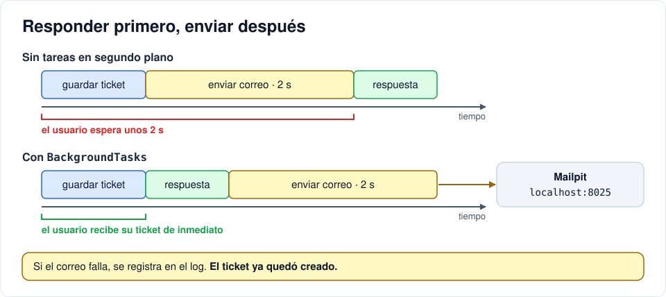

# Extra · Correos automáticos

[← 14 · Cierre: pruebas, despliegue y auditoría con IA](14-cierre.md) · [Volver al índice →](README.md) <!-- nav -->

**Clase:** ninguna (opcional) · **Entra en:** no se evalúa · **Duración:** 40 min · **Temas del plan:** integración de servicios, rendimiento.

Esta iteración es opcional. Hazla si tienes tiempo después de la 13; no está en el cronograma de clases.

## Lo que vas a construir

El sistema envía correos cuando pasa algo importante: bienvenida al registrarse, confirmación al crear un ticket, aviso al equipo de soporte, cambio de estado, cambio de rol y activación o desactivación de la cuenta. Los correos no salen a internet: los atrapa **Mailpit**, un servidor de correo de prueba que los muestra en una página web.

## Antes de programar

1. Enviar un correo puede tardar uno o dos segundos, o fallar si el servidor de correo está caído. ¿Debería el usuario esperar ese tiempo para ver su ticket creado? ¿Debería fallar la creación del ticket si el correo no sale?
2. El correo incluye el título y la descripción que escribió el usuario. ¿Qué podría hacer alguien malintencionado si pone código HTML en la descripción?

## Conceptos

### SMTP

Es el protocolo para **enviar** correos. Tu aplicación se conecta a un servidor SMTP (Gmail, Outlook, SendGrid...) y le entrega el mensaje. En desarrollo usamos Mailpit para no enviar correos reales por accidente.

### Tareas en segundo plano

FastAPI tiene `BackgroundTasks`: tareas que se ejecutan **después** de enviar la respuesta. El usuario recibe su ticket creado de inmediato y el correo sale después. Si el correo falla, se registra en el log, pero la operación del usuario ya quedó hecha.



### Inyección en correos

Si la descripción del ticket fuera `<a href="sitio-falso.com">Haz clic para recuperar tu clave</a>` y la metiéramos tal cual en el HTML del correo, el agente vería un enlace falso. Por eso el texto que viene de usuarios se **escapa** con `escape()`: `<` se convierte en `&lt;` y se muestra como texto, no como HTML. Lo mismo con el asunto: un salto de línea ahí permitiría inyectar cabeceras de correo, por eso se convierte a una sola línea.

## Paso a paso

### 1. Mailpit en Compose

En `docker-compose.yml`, agrega el servicio (al mismo nivel que `db` y `api`):

```yaml
  # Servidor SMTP de desarrollo: captura los correos y los muestra en http://localhost:8025
  mailpit:
    image: axllent/mailpit:latest
    ports:
      - "8025:8025"
```

Y en el servicio `api`, agrega `mailpit` a `depends_on`:

```yaml
    depends_on:
      db:
        condition: service_healthy
      mailpit:
        condition: service_started
```

### 2. Configuración

Agrega al `.env`:

```env
# Correo (Mailpit en desarrollo; en producción usa tu proveedor SMTP real)
SMTP_HOST=mailpit
SMTP_PORT=1025
MAIL_FROM=HelpDesk <no-reply@helpdesk.com>
FRONTEND_URL=http://localhost:4200
```

Y a `Settings` en `backend/app/config.py`:

```python
    smtp_host: str = "mailpit"
    smtp_port: int = 1025
    mail_from: str = "HelpDesk <no-reply@helpdesk.com>"
    frontend_url: str = "http://localhost:4200"
```

### 3. El módulo de correo

Copia `backend/app/mailer.py` del repositorio de referencia. No lo escribas a mano: léelo y responde estas preguntas.

1. ¿Qué hace `send_email` si el servidor de correo no responde? ¿Por qué no lanza el error hacia arriba?
2. ¿Dónde se usa `escape()` y dónde `_one_line()`? Relaciónalo con la sección de conceptos.
3. Las funciones `welcome`, `ticket_created_author`, etc. no envían nada: retornan una tupla `(destinatario, asunto, líneas)`. ¿Qué ventaja tiene separar "armar el correo" de "enviarlo"?
4. ¿A quién le avisa `staff_to_notify` y a quién excluye?

### 4. Enviar desde los endpoints

El patrón es siempre el mismo: agregar `background: BackgroundTasks` a la función y, después del `commit`, programar el envío:

```python
background.add_task(send_email, *mailer.welcome(user))
```

`*` desempaca la tupla: equivale a `send_email(destinatario, asunto, líneas)`.

Agrega en cada router las importaciones:

```python
from fastapi import BackgroundTasks
from .. import mailer
from ..mailer import send_email
```

Y luego aplica el patrón en estos puntos. Usa los archivos de referencia (`backend/app/routers/`) para comparar:

| Endpoint | Correo |
|---|---|
| `register` | `mailer.welcome(user)` |
| `create_ticket` | `mailer.ticket_created_author(ticket)` y, por cada persona de `mailer.staff_to_notify(db, exclude_id=user.id)`, `mailer.ticket_created_staff(ticket, staff)` |
| `update_ticket` | `mailer.ticket_status_changed(ticket)`, solo si el estado cambió de verdad, quien lo cambió no es el autor y el estado nuevo no es `open` |
| `update_user` | `mailer.role_changed(user)` si cambió el rol; `mailer.account_status_changed(user)` si cambió `is_active` |

Para saber si algo "cambió de verdad", guarda el valor **antes** de modificarlo y compáralo después del `commit`. En `update_ticket` necesitarás también al usuario que hace el cambio: agrega `actor: CurrentUser` a los parámetros.

### 5. Levántalo

```bash
docker compose up -d --force-recreate
```

## Comprueba

Abre http://localhost:8025 y, en otra pestaña, la aplicación:

1. Registra un usuario nuevo: llega el correo de bienvenida.
2. Con ese usuario, crea un ticket: le llega la confirmación y al admin (y a los agentes) el aviso.
3. Como agente, cambia el estado: le llega al autor.
4. Como admin, cambia un rol y desactiva una cuenta: llegan los dos avisos.
5. Crea un ticket cuya descripción sea `<b>hola</b>` y abre el correo del agente: debe verse el texto con los símbolos, no la palabra en negrilla.
6. Apaga Mailpit (`docker compose stop mailpit`) y crea un ticket. El ticket se crea igual; en `docker compose logs api` aparece el error del correo. Vuelve a encenderlo.

## Para pensar

- ¿Por qué no se avisa del cambio de estado cuando el autor lo cambió él mismo?
- Si el sistema tuviera 500 agentes, crear un ticket programaría 500 correos. ¿Qué problemas ves? ¿Cómo lo resolverías?

## Guarda tu avance

```bash
git add .
git commit -m "feat(api): correos automáticos con Mailpit"
```

---

[← 14 · Cierre: pruebas, despliegue y auditoría con IA](14-cierre.md) · [Volver al índice →](README.md) <!-- nav -->
